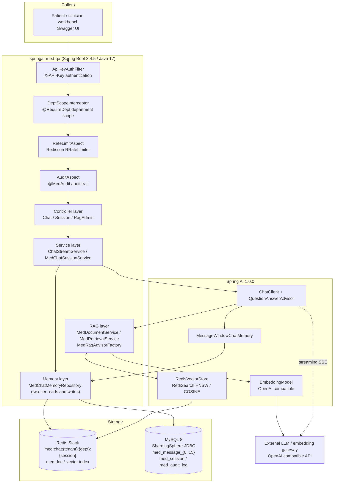

# springai-med-qa

<div align="center">

[](https://github.com/xxinjie21/springai-med-qa/actions/workflows/ci.yml)
[](https://github.com/xxinjie21/springai-med-qa/actions/workflows/docker-publish.yml)
[](https://github.com/xxinjie21/springai-med-qa/pkgs/container/springai-med-qa)
[](https://openjdk.org/)
[](https://spring.io/projects/spring-boot)
[](https://spring.io/projects/spring-ai)
[](./LICENSE)

A hospital-grade AI consultation backend built on **Spring Boot 3 + Spring AI**.

**English** ｜ [简体中文](./README.md)

</div>

> The "front-end business system" for medical AI question answering plus distributed conversation
> memory. The storage contract, field definitions and serialization protocol are strictly aligned
> with [`med-langchain-memory`](https://github.com/xxinjie21/med-langchain-memory) (the Python
> middleware), so the two repositories can read and migrate each other's data even though the code
> bases are completely independent and share zero dependencies.

---

## Table of contents

- [What this service is](#what-this-service-is)
- [Architecture](#architecture)
- [Tech stack and component choices](#tech-stack-and-component-choices)
- [Module layout](#module-layout)
- [Unified storage contract](#unified-storage-contract)
- [API surface](#api-surface)
- [Error codes](#error-codes)
- [Environment variables](#environment-variables)
- [Quick start](#quick-start)
- [Testing and coverage](#testing-and-coverage)
- [Alerting](#alerting)
- [CI/CD](#cicd)
- [Deployment](#deployment)
- [Roadmap progress](#roadmap-progress)
- [License](#license)

---

## What this service is

| Dimension | Description |
|---|---|
| Role | AI consultation backend (a working system for patients and clinicians) |
| Storage foundation | The shared medical conversation storage contract (Redis keys, 16 MySQL shards, Protobuf) |
| Capabilities | SSE streaming consultation, RAG over medical knowledge, patient ownership and department scoping, operation audit trail, privacy masking, rate limiting |
| Engineering principle | **Use mature commercial or mainstream open-source components** instead of rebuilding primitives |

---

## Architecture



**What happens on a request**

1. Authentication (`ApiKeyAuthFilter`) then department scope (`@RequireDept`) then rate limiting
   (`@RateLimit`) then auditing (`@MedAudit`): all four cross-cutting concerns are carried by
   framework mechanisms (a servlet filter, a handler interceptor, AOP) rather than hand-written code.
2. A consultation turn goes through `ChatClient` plus `QuestionAnswerAdvisor`; the context is
   supplied by `MessageWindowChatMemory`, whose short-term window is persisted through a custom
   `ChatMemoryRepository` into the two-tier store.
3. RAG performs vector similarity search with three metadata TAG filters
   (`tenant_id`, `dept_id`, `patient_id`) and **never parses or extracts entities from text**.
4. MySQL is the source of truth and Redis is a cache window: a failed cache read degrades to a miss
   (falling back to MySQL), while a failed cache write or delete is propagated.

---

## Tech stack and component choices

| Capability | Component | Notes |
|---|---|---|
| Base framework | Spring Boot 3.4.5 | Web, IoC, AOP, graceful shutdown |
| Model calls and streaming | Spring AI 1.0.0 | `ChatClient`, SSE streaming, `EmbeddingModel` |
| Vector store and RAG | Spring AI `RedisVectorStore` + `QuestionAnswerAdvisor` | HNSW with COSINE similarity, metadata TAG filtering |
| MySQL sharding | ShardingSphere-JDBC 5.5.2 | Only the `crc32(session_id) % 16` algorithm plugin is ours; routing belongs to the framework |
| Distributed lock and rate limiting | Redisson 3.45.1 (`RLock` / `RRateLimiter`) | Session lock with watchdog renewal, annotation-driven rate limiting |
| ORM and migrations | MyBatis 3.0.4 + Flyway | Data access and versioned DDL (V1 to V3) |
| Serialization | Protobuf 4.29.3 | Cross-language conversation protocol, stored as binary |
| Masking | Hutool `DesensitizedUtil` 5.8.37 | ID card, phone number and medical record number masking triggered by a Jackson annotation |
| API documentation | SpringDoc OpenAPI 2.8.5 | Swagger UI with chat, session and rag groups |
| Health checks | Spring Boot Actuator | `/actuator/health` with per-component MySQL and Redis probes, `/actuator/info` version matrix, Kubernetes liveness and readiness probe groups |
| Metrics and alerting | Micrometer, Prometheus, Alertmanager | `/actuator/prometheus` scrape endpoint; `com.med.qa.alert` pushes alerts to the log and to `med_qa_alert_total`, with rules and routing under `deploy/` |
| Testing | JUnit 5, Mockito, H2, Testcontainers | The unit suite is fully offline; integration tests skip themselves when Docker is unavailable |
| Coverage | JaCoCo 0.8.13 | Bound to `verify`; the report is a CI artifact and the `check` gate fails the build below the thresholds |

---

## Module layout

```
src/main/java/com/med/qa/
├── common/            # ApiResult/PageResult, ErrorCode/BizException, global exception handling
│   └── ratelimit/     # @RateLimit annotation plus the Redisson RRateLimiter aspect
├── config/            # Redis, Redisson, VectorStore, Embedding, ChatMemory, Security, OpenAPI wiring
├── domain/            # ChatMessageDO/ChatSessionDO/AuditLogDO plus RoleType/SessionStatus/AuditOutcome
├── memory/            # Official ChatMemory repository bridge, two-tier reads/writes, cache, lock, shard algorithm, Protobuf codec
├── rag/               # Document ingestion, tag-filtered retrieval, QuestionAnswerAdvisor factory
├── mapper/            # MyBatis mappers over the ShardingSphere data source plus type handlers
├── service/           # ChatStreamService / MedChatSessionService / AuditService
├── security/          # ApiKeyAuthFilter, PatientAccessGuard, @RequireDept department authorization
├── audit/             # @MedAudit annotation, AOP aspect, audit persistence
├── privacy/           # @Desensitize annotation, Jackson serializer, MaskType
├── actuator/          # MedStorageHealthIndicator plus MedComponentInfoContributor
├── alert/             # Alert chain: storage monitor, policy and deduplication, log and Micrometer sinks
├── controller/        # REST and SSE endpoints plus DTOs
└── MedQaApplication.java

src/main/resources/
├── application.yml             # Shared configuration with every environment placeholder
├── application-dev.yml / -prod.yml
├── sharding/med-sharding.yaml  # ShardingSphere rules (SHARDING plus SINGLE)
├── mapper/*.xml                # MyBatis SQL
├── db/migration/               # Flyway V1 to V3 DDL
└── META-INF/services/...       # Shard algorithm SPI registration

docs/                            # Deployment handbook
docker/mysql/init/               # Compose MySQL init script (database plus least-privilege account)
deploy/prometheus/               # Prometheus scrape config and alert rules
deploy/alertmanager/             # Alertmanager routing and inhibition rules
scripts/verify-docker-build.sh   # Real container build verification
```

---

## Unified storage contract

| Item | Rule |
|---|---|
| Redis key | `med:chat:{tenant}:{dept}:{session}` |
| MySQL shard | `med_message_{crc32(session_id) % 16}` (16 physical tables) |
| Message fields | `message_id(UUIDv7)`, `session_id`, `tenant_id`, `dept_id`, `patient_id`, `role`, `content`, `token_count`, `masked`, `created_at(epoch millis)`, `metadata` |
| Role enum | `PATIENT=0` / `DOCTOR=1` / `ASSISTANT=2` / `SYSTEM=3` |
| Serialization | Protobuf (`med_session.proto`, the cross-language protocol) in storage; JSON for API DTOs |

Both systems therefore write interoperable data: identical fields, keys, shard routing and encoding.

---

## API surface

Every endpoint requires the `X-API-Key` header (configurable through `MED_SECURITY_HEADER`).
Swagger UI: `http://localhost:8080/swagger-ui.html`. OpenAPI document: `/v3/api-docs`.

| Method | Path | Purpose | Notes |
|---|---|---|---|
| `POST` | `/api/chat/stream` | SSE streaming consultation (`text/event-stream`) | `@RateLimit` plus an identity taken from the API key (D41) |
| `POST` | `/api/sessions` | Create a consultation session | `@RateLimit` |
| `GET` | `/api/sessions/{sessionId}` | Read one session | Patients may only read their own |
| `POST` | `/api/sessions/{sessionId}/close` | Close a session (idempotent) | |
| `POST` | `/api/sessions/{sessionId}/archive` | Archive a session (idempotent) | An archived session can no longer be closed |
| `POST` | `/api/sessions/{sessionId}/restore` | Move a mis-archived session back | Requires the live copy to still exist, and retires the export certification (D51) |
| `GET` | `/api/sessions/{sessionId}/transcript` | Read a session's transcript (hot shard or cold copy) | The response names the `source` (`HOT` / `COLD`) and the canonical digest (D49) |
| `GET` | `/api/sessions` | Paged session listing | `tenantId`, `deptId`, `patientId`, `page`, `size` |
| `POST` | `/api/rag/documents/ingest` | Batch ingestion of medical documents | `@RateLimit`, staff only, identity taken from the API key (D42) |
| `POST` | `/api/rag/documents/delete` | Delete by isolation scope | Staff only; a department-wide delete needs `confirmDepartmentWide=true` (D42) |
| `POST` | `/api/rag/documents/search` | Tag-scoped retrieval preview | Staff only; forwards `topK`, `threshold` and `includeShared` (D42) |
| `GET` | `/api/audit/logs` | Paged review of the audit trail | Staff only; optional `operatorId` / `action` / `outcome` and a half-inclusive `[createdFrom, createdTo)` window; reading the trail is itself audited (D56) |
| `POST` | `/api/rag/documents/search` | Tag-scoped retrieval preview | Passes through `topK`, `threshold`, `includeShared` |
| `GET` | `/actuator/health` | Health check | Container and orchestrator probes |
| `GET` | `/actuator/prometheus` | Prometheus metrics | Scrape endpoint of the monitoring stack |

Unified response envelope:

```json
{ "code": 0, "message": "success", "data": { } }
```

Department-level documents use the reserved `patient_id` value `__shared__`; a patient query filters
with `patient_id IN [patient, __shared__]`, while tenant and department are equality conditions
combined with AND.

#### Identifier escaping (D36)

RediSearch's `TAG` query grammar reserves a set of characters (`-`, `.`, `:` and others), and the
official `RedisFilterExpressionConverter` writes the values it receives into the query **verbatim**.
`MedRetrievalFilters` therefore passes every tag value through `escapeTagValue`: reserved characters
get a backslash, so `patient-1` becomes `patient\-1`.

This is not optional. D36 measured two symptoms against a real Redis Stack:

| Case | Result without escaping |
|---|---|
| Equality filter `tenant_id == tenant-rag-a` | Redis rejects the query: `Syntax error at offset 24 near a`, so every retrieval in that department fails |
| `IN` filter `patient_id IN [patient-rag-1, __shared__]` | **No error at all**, but only `__shared__` comes back: the patient's own record is silently dropped and the answer rests on department guidelines alone |

Escaping applies to the **query** only. The metadata written into the index keeps the raw identifier,
and the `MedRetrievalFilters.matches` fallback check still compares raw values — the escaping lives
exactly at the query-syntax boundary. An identifier made of letters, digits and `_` escapes to
itself, so the common case produces a byte-identical query.

#### Where a streaming consultation gets its identity (D41)

The tenant / department / patient of `POST /api/chat/stream` come from the **authenticated principal,
never from the request body**. `ApiKeyAuthFilter` resolves the API key into a `MedPrincipal`,
`ChatStreamService` builds the session coordinate (`med:chat:{tenant}:{dept}:{session}`) and the RAG
isolation scope from it, and the body's `tenant` / `dept` / `patientId` are demoted to *consistency
claims* checked by `RequestIdentityGuard`:

| Claim in the body | Outcome |
|---|---|
| absent or blank | Accepted. The principal already carries the identity, so a client never has to repeat itself |
| matches the principal (surrounding whitespace ignored) | Accepted; the turn runs in the principal's scope |
| contradicts the principal | **403** (`tenant mismatch` / `department mismatch` / `patient mismatch`) |

The details: STAFF is department-scoped, so it may name any patient of its own department (that is how
a clinician opens a patient's consultation); PATIENT may only name itself, and a patient principal that
carries no patient id at all is refused rather than quietly widened into a department-wide scope. The
outcome collapses into one value object, `MedCallerScope` (the tenant/department/patient triple), from
which both the session coordinate and the RAG isolation scope are built — so the two can never end up
sourced from different identities.

Before the model is reached the endpoint also runs `PatientAccessGuard.assertScope` (scope-level
authorization) and `MedChatSessionService.requireWritableSession` (the session exists, belongs to the
caller and still accepts messages — a closed or archived transcript must never grow). Authorization
runs **before** capability: no refusal ever pays for an LLM call.

Every synchronous failure is answered before the SSE stream opens, with the matching status and a
single `error` event, instead of falling through to the global advice: `403` (identity or ownership),
`404` (unknown session), `400` (missing `session`/`message`, invalid scope combination) and `503` (no
model configured). The reason is practical — a `text/event-stream` response cannot render the advice's
JSON envelope, so letting it through would surface as an opaque content-negotiation error. The
cross-component contract is guarded by `StreamingIdentityContractTest`, which runs the real
API key → principal → controller → service → guards chain and asserts both that a body claiming
someone else's identity is refused and that, when the body claims nothing, the coordinates reaching the
session layer are the **principal's**. That is exactly the class of defect the review found when 1389
single-component tests could not notice that a guard was never called.

**That contract test immediately caught a defect (D41).** `ChatStreamService`'s javadoc promised that a
deployment without a `ChatClient.Builder` is rejected with `LLM_SERVICE_ERROR`, but Spring AI declares
that builder with a **mandatory** `ChatModel` parameter and `ObjectProvider.getIfAvailable()` does not
swallow an instantiation failure — so a deployment with no model received a bean-creation stack trace
and a `500` instead of the documented 503. The fix folds `BeansException` and "returned null" into the
same business error (`resolveChatClientBuilder`). This is precisely the "the comment promises one thing,
the code does another" category the review named, and it is only visible to a test that drives the
**real** `ObjectProvider` — a mock always returns null, which is why 1389 tests never saw it.

#### Where the RAG administration surface gets its scope (D42)

The three `/api/rag/**` endpoints (ingest, delete, search) take their tenant / department / patient
**from the API key as well**. The identity fields in the body are consistency claims checked by the same
`RequestIdentityGuard`: absent means "use the principal's own value", and a contradiction is refused.
Before D42 these endpoints treated the body's scope as authoritative, so any staff key could read, write
and even physically delete another department's vectors just by putting that department's `deptId` in the
JSON — P0-3 of the 2026-09-25 review.

| Change | Why |
|---|---|
| The body's tenant/dept/patient are demoted from authority to claims | Letting the request body decide who sees what is what caused P0-3; the scope can now only come from the authenticated identity |
| Deletion no longer accepts `ids` | The store keys documents by id, the isolation tags live inside the JSON value and RediSearch does not index the key, so "these ids **and** my scope" cannot be expressed as one filter — and a scope-less `VectorStore#delete(List)` can never be made safe. The primitive was removed rather than guarded |
| A department-wide delete must set `confirmDepartmentWide=true` | A department scope takes the department's shared guidelines with it, after which every consultation there answers from a corpus without its protocols. A destructive action has to be confirmed (the same two-switch idea as D38) |
| The controller re-checks the staff role itself | `MED_SECURITY_DEPT_SCOPE_ENABLED=false` removes the `@RequireDept` interceptor while leaving authentication intact; the extra check makes the surface fail closed on its own |

A refusal shows up in two shapes, both deliberate and both pre-existing conventions: a refusal written by
the **interceptor** is a real HTTP `403`, whereas a `BizException` raised **inside the handler** (a
contradicting identity claim, an unconfirmed department-wide delete) follows the project-wide convention
of HTTP `200` with the business code `40300` / `40000` in the `ApiResult` envelope — **the business code
is the authoritative signal, not the status line**.

The cross-component contract is guarded by `RagAdminAuthorizationContractTest`, which runs the real API
key → interceptor → controller → guard → service chain and asserts both that a body claiming someone
else's identity is refused with no service interaction at all, and that when the body claims nothing the
coordinates reaching the services are the **principal's**. Following project convention the guard was
**watched failing first**: restoring "body wins" broke 12 cases across the two test classes.

#### What the durable transcript keeps (D44)

`MessageWindowChatMemory` decides **how many messages the model may see** (`MED_CHAT_MAX_MESSAGES`,
20 by default). It is not the record of the consultation. Yet the write path up to D43 was
"`deleteSession`, then `appendAll`" — and what Spring AI hands to `saveAll` is precisely the **trimmed
window**, so every turn physically deleted the messages that had scrolled out of it: after a
consultation of several dozen turns the database permanently held the last 20, while the repository's own
javadoc called MySQL the "authoritative copy". With two instances serving the same session it was worse
still: two turns deleted each other's messages.

D44 turns "the window is a view, the transcript is the record" into a code fact:

| Tier | What it holds | Bound |
|---|---|---|
| MySQL `med_message_{crc32(session_id)%16}` | the **full transcript**; every turn is only ever added | none |
| Redis `med:chat:{tenant}:{dept}:{session}` | the most recent `MED_CACHE_MAX_MESSAGES` (200 by default) | a bounded cache, re-read from MySQL on a miss |
| `MessageWindowChatMemory` | the most recent `MED_CHAT_MAX_MESSAGES` (20 by default) | bounds the prompt only |

- `ChatMessageMapper.insertIfAbsent` (`INSERT … ON DUPLICATE KEY UPDATE message_id = message_id`)
  deduplicates by primary key: `1` means "inserted", `0` means "already stored". `INSERT IGNORE` was
  rejected because it would also swallow truncation and other constraint failures.
- `MedChatMemoryRepository.saveWindow` only ever appends idempotently — **no code path deletes any more** —
  and then publishes the window it wrote to the Redis cache, so the cache matches what the model sees. A
  cold-cache replay is truncated to `MED_CACHE_MAX_MESSAGES`: MySQL now holds the whole transcript, and an
  untruncated replay would push a long consultation's entire history into the model prompt.
- The write runs under `SessionLockService`'s `RLock` (`med:lock:chat:…`): a second concurrent turn for the
  same session fails fast with `SESSION_LOCKED` instead of interleaving its write.
- **No `@Transactional`, deliberately**: the write is idempotent and Spring AI re-sends the whole window on
  every turn, so a partial batch heals itself on the next turn — whereas refreshing Redis inside a
  transaction that later rolls back would leave a window holding messages the database never accepted,
  the one inconsistency this layer refuses to create. The trade-off is documented on `saveWindow`.

The cross-component contract is guarded by `ChatMemoryWindowIntegrationTest` (offline: a 2-message window
against a 5-message transcript) and by
`MedStorageAndLockIntegrationTest#memoryWindowTrimsButTranscriptKeepsEveryTurn` (real MySQL + Redis Stack:
a 4-message window against 10 rows in the shard). Single-component tests cannot see the difference — the
bridge test only observes the messages handed to the repository, and the repository test never runs the
window.

**That contract test found a second defect on its first run** (D44): `med_message.patient_id` is `NOT NULL`
in the unified storage spec, but the messages Spring AI hands over carry **no project identity at all** —
the patient is not part of the conversation id (`tenant:dept:session`) and the assistant message is built
entirely by the framework. Every turn of every consultation therefore failed to persist with
`Column 'patient_id' cannot be null`: every unit test mocked the mapper and every integration test used
`sampleMessage`, which sets the patient explicitly, so no test ever exercised "a framework message is
stored". The fix resolves the session's patient through `ChatSessionMapper.selectById` before the window is
written (the session is the only authority on who a message belongs to); a patient id carried by the
message itself wins, and an unknown session or a session without a patient refuses the write with
`STORAGE_ERROR` rather than storing an unattributable medical record.

#### Keeping isolation metadata out of the embedded text (D45)

`spring.ai.openai.embedding.metadata-mode` used to be `EMBED`, directly under a comment claiming
"metadata tags stay out of the vector" — the comment and the code contradicted each other, the same
deviation phases 8 and 9 keep removing, except this time the deviation was in the **data**.

Verified at bytecode level against Spring AI 1.0.0: `OpenAiEmbeddingModel.embed(Document)` first
hands the document to `document.getFormattedContent(metadataMode)`, and `DefaultContentFormatter`
reads `EMBED` as "**every** metadata key minus `excludedEmbedMetadataKeys`". So `tenant_id`,
`dept_id` and `patient_id` were spliced into the text sent to the embedding endpoint: similarity
was polluted by the tags, and the isolation labels were themselves written into the vector. Worse,
`EMBED` is also the field initializer of Spring AI's own `OpenAiEmbeddingProperties.metadataMode`,
so "this key is not configured" is not the same thing as safe.

D45 turns the rule into a code fact:

- `metadata-mode: NONE` embeds the document text alone; the tags stay in the JSON value. RediSearch
  still indexes all three as `TAG` fields per `med.rag.vector-store.metadata-fields`, so
  **department/patient filtering loses nothing** — only the text that reaches the vector changes.
- **Deliberately not an environment variable**: a deployment must not be able to switch the
  isolation tags back into the vector.
- `EmbeddingModelConfig.SAFE_METADATA_MODE = NONE`, the fallback when the property is absent
  (cleared, or deleted): "not configured" has to fail safe rather than inherit Spring AI's `EMBED`
  default.

The cross-component contract lives in `EmbeddingMetadataContractTest`. It binds the **effective**
value through Spring Boot's own `YamlPropertySourceLoader` and `Binder` (overlaying every profile,
so no profile can bring `EMBED` back) and asserts that

1. the effective value is `NONE` and equals the code's fallback constant;
2. `med.rag.vector-store.metadata-fields` still declares the three `TAG` fields and
   `med.rag.index.expected-tag-fields` still matches them (otherwise the D37 probe would report a
   freshly rebuilt index as drifted);
3. **the difference is demonstrated against the real Spring AI formatter**: the same `Document`
   yields an embedded text with no tags at all under `NONE` and with all three under `EMBED`, so
   "why this setting matters" no longer rests on a comment;
4. the guard rejects `EMBED` and rejects a missing value, i.e. it cannot pass vacuously.

As this project requires, the guard was **seen to fail first**: switching `application.yml` back to
`EMBED` turned 3 cases red (`effectiveMetadataModeEmbedsTextOnly`,
`noProfileReintroducesEmbeddedMetadata`, `configuredModeMatchesTheCodeFallback`), and the file was
restored and re-verified green.

#### Window semantics and deployment prerequisites corrected (D46)

D46 adds no behaviour; it aligns the last three places where the comment promised something the code
did not do, each with its own guard test:

- **Window semantics (the residual P2 item)**: the javadoc of
  `MedChatMemoryRepository#findAll` still said the read path "replays the whole transcript from
  MySQL", contradicting the paragraph right below it that bounds the answer by
  `med.cache.max-messages`. It now states that `findAll` returns a **bounded window** (the cached
  window on a hit; on a miss the transcript replayed from MySQL and truncated to that window) and
  that `reload` is the repository's **only** read that returns the whole transcript (for verification
  and repair, and even then the cache it warms is trimmed by the native `LTRIM`).
  `RedisMessageCache`, `MedCacheProperties` and `MedChatMemoryProperties` now say the same thing:
  `med.cache.max-messages` bounds the cache and a cold-cache replay, `med.chat.max-messages` bounds
  the prompt, and **neither bounds the stored transcript** — while `MED_CACHE_MAX_MESSAGES=0`
  disables both bounds at once (an operational risk, not a tuning knob).
- **Deployment prerequisites (P2-3 and P2-4)**: section 1 of `docs/DEPLOYMENT.md` promotes "the MySQL
  database default charset must be `utf8mb4`" from a passing remark to an **explicit prerequisite** —
  the V1 DDL deliberately omits `DEFAULT CHARSET` so the same script can run against H2, Compose
  covers it with `--character-set-server=utf8mb4`, and a self-hosted MySQL that does not will store
  Chinese clinical text as **silent mojibake**. It also records that `characterEncoding` must be the
  **Java** charset name `UTF-8`. The same section explains why H2 stays on the production classpath
  (`runtime` scope: narrowing it to `test` breaks ShardingSphere startup) and that the **H2 console is
  not enabled in any configuration file and must not be**.
- **The privacy layer contradicting itself (P2-1)**: `MaskType`, `privacy/package-info` and
  `@Desensitize` all claimed that no mask pattern is hand-written here, while
  `MaskType.maskKeepEdges` is exactly that. They now say what is true: phone numbers and national ID
  cards are delegated to Hutool, and the medical record number uses a keep-edges mask because Hutool
  ships no strategy for it.

Guards: `MemoryWindowSemanticsTest` (the window contract plus **the retired wording must not come
back**), `PrivacyMaskingDocumentationTest` (the absolute claims must not reappear) and
`DeploymentPrerequisiteTest` (the prerequisites are in the handbook, a scan of Spring's own
configuration files (`application*`) proves none of them enables the H2 console, `pom.xml` still keeps
H2 at `runtime` scope, and compose really pins `utf8mb4`).

#### Stale consultations archived automatically (D47)

The javadoc of `MedChatSessionService#archiveSession` has documented two ways a consultation ends
since D20: an explicit close, or **a retention job sweeping stale sessions**. That job did not exist.
`ARCHIVED` was therefore reachable only through one explicit API call: a patient who opened a session,
asked a single question and never came back left a row that stayed `ACTIVE` forever, keeping its Redis
window warm (re-filled from MySQL on every read once the TTL expires), while `med_session` only ever
grew. Same class of defect as phases 8 and 9 — **a comment promising behaviour the code does not
have** — except that this time what was promised is a background capability, and its absence could not
turn a single test red.

D47 makes it real and answers the two questions that follow:

- **Why it cannot archive a live consultation** — not because the job is fast, but through two
  independent mechanisms. (1) The staleness predicate travels **inside the archiving statement**
  (`ChatSessionMapper#updateStatusIfStale`:
  `UPDATE … SET status=ARCHIVED WHERE session_id=? AND status=ACTIVE AND updated_at <= :idleBefore`).
  The sweep reads its candidates first and archives them afterwards, so a patient may well come back
  in between — the database then refuses that row instead of a read-then-write window losing the race.
  (2) The archive runs under **the same session lock the message-append path takes**, and a lock held
  by a live turn counts as `skipped`, never as a failure: a busy session is an alive one.
- **Why it cannot reuse `archiveSession`** — the request-scoped `PatientAccessGuard` fails closed when
  there is no principal (by design, D21), which is exactly the situation of a background job, so every
  candidate would be rejected with `FORBIDDEN`. The inverse shortcut is just as wrong: adding a
  "skip the guard" method to `MedChatSessionService` would hand every request path an unguarded
  archive primitive. So `MedSessionRetentionService` owns a system-side archive path and reuses only
  the collaborators that actually encode the invariants (the mapper's compare-and-set, the session
  lock, the cache eviction), with the reasoning written into its class javadoc.

The remaining engineering choices: cluster-wide mutual exclusion through a Redisson `RLock`
(`med:lock:session:retention`; a replica that loses the race reports `skipped-lock-held` without
touching MySQL); `med.session.retention.enabled` defaults to `false` (an optional capability needs a
switch) **and** `dry-run` defaults to `true` (enabling the capability still changes nothing until an
operator has read a report — the same two-switch design as the D38 index rebuild); `batch-size ×
max-batches` bounds one run and `remaining` reports the backlog; **no message is ever deleted**, so a
wrongly archived session can be moved back. A new V4 migration adds
`idx_med_session_retention (status, updated_at)`, because this is the only query in the repository
with no tenant dimension — without the index every run would be a full table scan. Alert codes:
`session-retention-completed` (INFO, only when something was really archived) and
`session-retention-failed` (WARNING — it does not page, but it must not be silent either, because
**"the job stopped running" and "the hospital has no abandoned sessions" look identical**).

Guards: `MedSessionRetentionServiceTest` (a held mutex means MySQL is never touched, a dry run writes
nothing, a compare-and-set that returns 0 counts as skipped, one failing candidate never aborts the
run), `ChatSessionMapperRetentionShardingTest` (the predicate and the status-code mapping of all three
statements against the real DDL) and `MedSessionRetentionConfigTest` (the switch really adds and
removes the beans, and the `@Scheduled` placeholder keys really exist in `application.yml` — otherwise
the job silently falls back to the annotation's literal default and the operator's value is ignored).
As usual for this repository, the staleness predicate was **watched going red first**: deleting
`AND updated_at <= :idleBefore` from the SQL made
`updateStatusIfStaleRefusesARefreshedSession` fail immediately (`expected: <0> but was: <1>`), and it
was restored and re-verified green.

#### Cold archive export of archived consultations (D48)

D47 flips the status to `ARCHIVED` and drops the Redis window, but **the transcript never moves**: it
stays in the 16 sharded `med_message_*` tables. So "this consultation is archived" had **no verifiable
counterpart in storage** — no cold copy, and no digest that could prove a cold copy complete. D48
supplies that half: the full transcript of every archived session is copied, in the storage-spec
Protobuf encoding, into the **non-sharded** `med_message_archive` table, and one manifest row is
written into `med_session_archive` (`message_count` + `payload_checksum`). What is stored is the frozen
Protobuf bytes, so the heterogeneous Python middleware can read it from its own `med_session.proto` —
the first executable landing point of the "two systems can read each other's data" promise in section 4
of the roadmap.

Engineering choices:

- **The cold tables are deliberately not sharded**: a session's transcript is one contiguous range read
  (primary key `(session_id, message_id)` plus `idx_med_message_archive_session`) instead of a
  scatter-gather across 16 shards. The sharding rule exists to keep the **write** path of live
  consultations cheap; cold data has no write path.
- **Certification requires evidence, not "the INSERT returned 1"**: (1) the transcript is read once to
  build the copy and **read again** afterwards, and the two digests must agree; (2) the cold copy is
  read back and **re-hashed**, and must reproduce the source digest. Only then is the manifest written.
  The first check rests on "`ARCHIVED` is terminal and the write path only accepts `ACTIVE`
  (`requireWritableSession`)" — but that invariant belongs to **another component**, so the export does
  not take it on faith: if a future change made archived sessions writable again, this reports
  `mismatched` instead of leaving a silently stale cold copy.
- **One definition of the digest** (`SessionArchiveChecksum`): per message, the line
  `message_id \t created_at \t sha256hex(payload)`, joined and hashed once more with SHA-256; an empty
  transcript hashes to `sha256("")`, which is distinguishable from "never exported". No custom hashing —
  the Python side recomputes the same digest from the same rule.
- **A refusal is not a dead end**: rows are copied first and certified afterwards, the copy is
  idempotent (primary key plus `ON DUPLICATE KEY UPDATE`), and a refused session has no manifest, so it
  stays a candidate for the next run, which copies only the missing messages and re-certifies.
- **The candidate query uses `NOT EXISTS`**: paging through `med_session` by `updated_at` and filtering
  in Java would fetch the same fully exported page on every run — the oldest archived sessions are
  exactly the ones an earlier run already exported — and the backlog behind it would never be reached.
- **Two switches**: `med.session.archive.enabled` defaults to `false` and `dry-run` to `true` (the same
  design as the D38 rebuild and the D47 sweep); cluster-wide mutual exclusion uses
  `med:lock:session:archive:export` (a replica that loses the race reports `skipped-lock-held` without
  touching the database); `batch-size × max-batches` bounds one run. A V5 migration creates both cold
  tables and lists them in the `!SINGLE` rule.
- **Nothing is deleted**: the export only inserts, the hot shards are read-only for this job, and the
  cold store has no delete path. D47 promised that "a wrongly archived session can be moved back", which
  deleting hot rows would invalidate; purging is a separate, irreversible operation that needs its own
  guard and its own iteration.

Alert codes: `session-archive-completed` (INFO), `session-archive-mismatch` (WARNING — a copy was
refused certification) and `session-archive-failed` (WARNING). None of them pages (the export only ever
inserts, so no clinical data is at risk), and none of them is silent either, because **"the job stopped
running" and "the hospital has nothing to archive" look identical**. An operator can re-check one
session by name: `MedSessionArchiveExportService#verify` answers `VERIFIED` / `MANIFEST_MISSING` /
`TRANSCRIPT_CHANGED` / `COLD_COPY_DIFFERS`, of which **only the last one points at the cold store
itself**; it is deliberately not reachable from any controller (it reads a transcript by session id
with no tenant scope, so it must never be handed to a request-scoped caller).

Guards: `MedSessionArchiveExportServiceTest` (a held mutex means MySQL is never touched, a dry run
writes nothing, a source that moves mid-copy or a cold copy that fails the digest is **refused
certification**, one failing session never aborts the run), `SessionArchiveMapperShardingTest` (V5's
tables, the `NOT EXISTS` candidate query excluding exported sessions, the idempotent insert, a byte-exact
BLOB round trip and the manifest compare-and-set, all against the real DDL) and
`MedSessionArchiveConfigTest` (the switch really adds and removes the beans, and the `@Scheduled`
placeholder keys really exist in `application.yml`).

#### Reading an archived transcript (D49)

D47 made `ARCHIVED` reachable by a **job**, and D48 gave it a **verifiable credential** in storage — but
across both iterations **the transcript itself became unreadable from the application**. Archiving
evicts the Redis window, and no code path in the service returns a session's messages:
`ChatController` only appends a turn, `SessionController` only creates / gets / closes / archives /
lists, and `MedSessionArchiveExportService#verify` reads the cold store solely to recompute a digest and
is deliberately not reachable from the request path. So "archived" meant "gone": a clinician could see
the `med_session` row (`status=ARCHIVED`) and none of what was said in it — the cold copy was the only
thing that could prove what had been archived, and the service could not read it. D49 adds that **read**
path, and it adds the read *before* anything is allowed to delete: **without a read path no hot row may
ever be removed**, which is why D50 will stand on a read path already proven to work.

`MedTranscriptService#read(tenantId, deptId, sessionId)` returns a `SessionTranscript` (`sessionId`,
`status`, `source`, `checksum`, `messages`). **Which copy answers is decided by a digest, never by an
ordering or a flag**:

- Not `ARCHIVED`, or archived with **no export manifest** → the shard is the only copy and is returned
  (`source=HOT`). "Archived but never exported" is the normal state of a deployment that has not armed
  `med.session.archive.enabled`, and refusing it would turn an optional background job into a
  prerequisite for reading clinical records.
- With a manifest, the live transcript is re-hashed through `TranscriptDigests`: if it reproduces the
  manifest's `payload_checksum`, the shard still holds the certified transcript and is returned (`HOT`).
- Otherwise the cold copy is read and hashed the same way: if it reproduces the manifest, it is returned
  (`COLD`), each payload decoded back into the storage-spec entity by `ProtoMessageCodec#decodeMessage`.
  That covers both the state D50 will create deliberately (hot rows gone) and the state a half-finished
  purge leaves behind (hot rows partially gone), so D50 needs no extra branch.
- **If neither copy reproduces the certification the read is refused** with `STORAGE_ERROR`: returning
  the shard would serve bytes the archive says are not the transcript, and returning an empty transcript
  would report data loss as "this consultation was empty".

Engineering choices:

- **Authorization is delegated, never re-implemented**: `read` resolves the session through
  `MedChatSessionService#getSession`, so a session of another tenant/department is reported as
  `NOT_FOUND` and a patient reading somebody else's consultation is refused by `PatientAccessGuard`
  (`FORBIDDEN`). The read path adds no "read by session id" primitive to the request surface — the hole
  class D41/D42 closed.
- **One definition of the digest**: the new `TranscriptDigests` gathers "live transcript → canonical
  digest" and "cold copy → canonical digest", and `MedSessionArchiveExportService`'s two private
  implementations now delegate to it, so "what the export certified", "what a verification recomputes"
  and "what a read trusts" cannot become three different notions of equality.
- **No lock and no switch**: the append path re-sends the whole window on every turn and writes each
  message idempotently (D44), so a read can only ever see complete rows, and the cold copy is a frozen
  snapshot. Reading is a core capability — a switch would only give an operator a way to make clinical
  records silently unreadable.
- **The response exposes `source` and `checksum`**: an operator compares the digest against
  `med_session_archive.payload_checksum`, and a client can notice that a transcript changed between two
  reads. The message DTO is **not** text-masked: the privacy layer covers phone numbers, id cards and
  medical-record numbers, while the clinical text *is* the record and the caller has already been
  authorized for it.

Guards: `MedTranscriptServiceTest` (a hot read never touches the archive, an archived-but-unexported
session still reads its shard, a partially purged shard loses to the cold copy, an unaccountable
transcript is **refused**, a malformed payload is refused rather than skipped, storage failures map to
`STORAGE_ERROR`), `SessionTranscriptTest`, `TranscriptDigestsTest`, `TranscriptResponseTest` /
`MessageResponseTest`, `SessionControllerTest`, and `MedStorageAndLockIntegrationTest`, which proves
against real MySQL that a transcript can still be read back through `med_session.proto` after the hot
rows are deleted.

#### Purging the hot shards of a certified cold copy (D50)

D47 archives, D48 certifies a cold copy, D49 reads that copy back — and yet after all three the 16
sharded `med_message` tables had **not lost a single row**: "archived" never made the hot tier smaller,
so the cold/hot split was only half done. D50 finishes it, and it is the **only code path in the project
that deletes clinical data**, which is why it carries the most guards.

**Why it may delete anything**: a deletion is only accountable when a second, certified copy of exactly
those bytes exists. So a candidate has to pass **two independent proofs**, and their order is not an
implementation detail:

- **The cold copy is verified first.** The manifest (`med_session_archive.payload_checksum`) certifies a
  digest, and the cold copy must reproduce it under the same canonical form
  (`TranscriptDigests.ofArchived`). **Until it does, the hot rows are the only copy of the transcript**,
  and deleting them would be data loss — so when the cold copy fails, the shard is not even read.
- **Then the live shard.** The live transcript must reproduce the same digest under
  `TranscriptDigests.ofTranscript`. A drifted shard holds messages **nobody certified**, and deleting
  them would destroy the only record of them — so a drift is **refused** too, and the certified copy
  stays safe in the cold store.

A candidate has exactly three outcomes: **certified and still hot** → delete the rows and mark the
session retired; **certified but no hot rows left** → nothing to delete, but the session is still marked
(otherwise the oldest retired sessions would be fetched on every run and the job would never reach the
ones behind them); **not accountable** → refused, neither deleted nor marked, counted in `refused` and
reported with its reason.

Engineering choices:

- **The retirement marker lives on `med_session.purged_at`, not on the cold tables** (V6 adds the
  nullable column). The archived rows are the **evidence** of what was archived and the manifest is the
  **certification**; nothing in this project writes to either after the export and D50 does not break
  that — it only ever deletes from `med_message`. The `purged_at IS NULL` predicate therefore has to stay
  in the SQL: inferring "already purged" by reading the shards would re-fetch exactly the sessions a
  previous run retired, and the job would never make progress (the same trap D48 called out).
- **Delete first, mark second**, rather than one statement (they live in different domains — a sharded
  table and the session registry — and the order matters): an interruption leaves a session whose rows
  are gone but which is still a candidate, and the next run finds nothing to delete, marks it and
  converges. The reverse order could leave rows nobody ever looks at again.
- **A cooling-off window, `min-archived-age`, defaults to 7d**: D47 promised that "a wrongly archived
  session can be moved back", and moving it back needs the transcript to still be there. The window is
  the mechanism that keeps that promise from becoming an empty one — not the hope that the job runs
  slowly.
- **Three conservative knobs**: `enabled=false`, `dry-run=true`, plus the cooling-off window. A dry run
  still performs the **full verification** (manifest, both copies, both digests), so its report is not
  "how many candidates exist" but "how many would be retired and how many would be refused" — which is
  the report an operator needs to decide whether to arm the job.
- Cluster-wide mutual exclusion uses `med:lock:session:purge` (losing the race reports
  `skipped-lock-held` without touching the database); `batch-size × max-batches` bounds one run and
  `remaining` reports the backlog.
- **Since D51 every candidate is also processed inside its session lock, with the status re-read inside
  it.** The original design deliberately skipped that lock, and the argument was written down: the
  candidates are all `ARCHIVED`, which `SessionStatus#isWritable()` excludes from the write path, and what
  actually detects a torn read is the digest comparison (a lock prevents one, a checksum notices one).
  D51 added the first writer that can *leave* `ARCHIVED` — the restore — and that premise died on the
  spot, because a checksum **cannot see it**: restoring changes the status and the certification without
  touching a single transcript byte. A candidate that was `ARCHIVED` when the batch was selected and
  `ACTIVE` when its rows were deleted would be a consultation a clinician had just moved back, reported
  by the read path as empty. Every candidate is now handled inside the `SessionLockService` session lock
  and re-read (`selectById`) inside it; a candidate that is no longer `ARCHIVED` is `skipped` with zero
  writes, and a busy lock is `skipped` too rather than a failure (the D47 convention). Not one digest
  check was removed.
- Alert codes: `session-purge-completed` (INFO, only when something was really deleted and it was not a
  dry run), `session-purge-refused` (WARNING — **nothing was deleted**, but it is the only signal that
  says the two copies of a consultation disagree, and it will not clear on its own), and
  `session-purge-failed` (WARNING). **"The job stopped" and "the hospital has nothing to purge" look
  exactly alike.**

Guards: `MedSessionPurgeServiceTest` (a replica without the mutex touches no row, a dry run writes
nothing yet verifies everything, **the shard is not even read while the cold copy fails**, a drifted
shard is refused rather than deleted, an emptied shard is still retired, a failed delete leaves no mark,
one failing candidate never aborts the run), `SessionPurgeMapperShardingTest` (V6 adds the column, the
candidate query needs all four predicates, `markPurged` is a compare-and-set, and `deleteBySessionId`
removes one session's rows from one shard without touching the cold tables), `MedSessionPurgeConfigTest`
(the switch really adds and removes beans, and the `@Scheduled` placeholder keys exist in
`application.yml`), `MedSessionPurgeSchedulerTest` (the completion / refusal / failure alerts, and
silence on a dry run), and `MedStorageAndLockIntegrationTest`, which runs the whole chain against real
MySQL and Redis: **`MedSessionPurgeService` really deletes the hot rows, and D49's read path then serves
the cold copy**. As the project's convention requires, both load-bearing guards were **watched to go
red**: replacing "refuse when the cold copy does not reproduce the certification" with "delete anyway"
turned exactly `MedSessionPurgeServiceTest$Refusals.refusesWhenTheColdCopyDiffers` red, and dropping
`purged_at IS NULL` from the candidate query turned exactly `purgedSessionsLeaveTheCandidateSet` red;
both were reverted and re-verified green.

#### Moving a mis-archived session back (D51)

**This closes the sentence that six places cite and no code implemented.** `MedSessionRetentionService`'s
class javadoc, `MedSessionArchiveProperties`, `MedSessionPurgeProperties#minArchivedAge`, `application.yml`
and both READMEs all say "a wrongly archived session can be moved back", and D50 even paid for it with a
seven-day cooling-off window — yet nothing in the service could move one back: `MedChatSessionService`
offered create / get / close / archive / list only, and `closeSession`'s javadoc called `ARCHIVED` the
terminal state. Sixth instance of the phase-8-to-11 defect class — **a comment promising behaviour no code
provides** — and this time the cost of the promise had already been paid.

`MedSessionRestoreService` (a permanent `@Service`, deliberately **with no switch**: it is the inverse of
`archiveSession`, and a switch would let an operator make a mis-archived consultation unrecoverable)
exposes `ChatSessionDO restore(tenantId, deptId, sessionId)`, behind
`POST /api/sessions/{sessionId}/restore`. Authorization is entirely delegated to
`MedChatSessionService#getSession` (a patient may only restore their own consultation; another
tenant/department is reported absent), **no new "mutate a session by id" primitive was added** (the
D41/D42 lesson), and the transition runs inside the session lock.

**Moving back requires the live copy to still be the certified transcript.** Three checks, in order:

1. the status must be `ARCHIVED` — nothing else needs restoring;
2. `med_session.purged_at` must be `NULL` — once the purge reclaimed the hot rows there is no live copy;
3. when a manifest exists, the live transcript must reproduce its `payload_checksum` (through
   `TranscriptDigests`, the same digest the export, the verification, the read path and the purge use).

Check 2 is not redundant with check 3: the digest comparison catches a shard that drifted, while an
emptied transcript reproduces `sha256("")` and would slip past it.

**Restoring deliberately does not rebuild the hot rows.** Re-materialising `med_message` from
`med_message_archive` would turn archiving into a physically reversible operation, and D50's cooling-off
window exists precisely for "restorable *before* the reclamation". After the reclamation the consultation
is not lost — D49's read path still serves it from the certified cold copy — it simply stops being
reversible. That boundary is the answer to "why seven days": **the window is not a delay, it is the
restore window.**

**The certification is retired before the status is flipped, and the order cannot be swapped.** First
`SessionArchiveMapper#deleteManifest`, then
`ChatSessionMapper#updateStatus(sessionId, ACTIVE, ARCHIVED, now)`. The manifest is a *state* row (both the
D48 export query and the D50 purge query read it) while the cold rows are the evidence, so the manifest is
what leaves. An interruption in between leaves "ARCHIVED with no manifest", which the next export
re-certifies from the very same transcript and therefore converges; the reverse order would leave an
`ACTIVE` session carrying a manifest for the transcript as it was before it became writable again, and
since the export's candidate predicate is `NOT EXISTS (manifest)` it could **never** be re-certified — the
cold copy would keep claiming to be a transcript that no longer exists, and the purge would refuse it on
every run. Retiring the claim deletes no byte: it happens only after the live rows have been shown to
reproduce what it certified, and re-certifying is one export away.

**Both cold-tier jobs gained the session lock in the same iteration.** D48 and D50 both argued they could
skip it because the candidates were `ARCHIVED` and the write path rejects an archived session, so a
checksum was all they needed. Restoring invalidates that, and a checksum cannot see it.
`MedSessionPurgeService` and `MedSessionArchiveExportService` now process each candidate inside the session
lock and re-read the status inside it; a candidate that is no longer `ARCHIVED` is `skipped` with zero
writes. The export case is the nastier one: certifying a session that was just restored would leave it
permanently un-certifiable.

Guards: `MedSessionRestoreServiceTest` (restore, non-archived refused, a retired live copy refused, a
drifted shard refused, restore with no manifest, and an `InOrder` assertion that the manifest is retired
**before** the status flips), `SessionControllerTest`, `MedSessionPurgeServiceTest` /
`MedSessionArchiveExportServiceTest` (**a busy lock is `skipped` and not one mapper is touched**, a
candidate the restore moved back is `skipped` with zero deletes, and **the status re-read happens inside
the session lock**), plus `MedStorageAndLockIntegrationTest` on real MySQL and Redis running the full loop:
**archive → export → restore (rows byte-identical, status `ACTIVE`, certification retired) → append a new
turn → archive again → export again (the cold copy grows to four rows) → reclaimable**, alongside "restore
is refused once the hot rows were reclaimed, and the record is still readable from the cold copy" and "a
session whose lock is held by another thread is skipped by the purge with every row intact".

#### Reclaiming orphaned cold copies (D52)

**What this closes is the tail D51 created for itself.** Restoring a mis-archived session retires its
export certification but leaves every byte in `med_message_archive` exactly where it was — so the cold
table ends up holding a snapshot **with no manifest**. Such a snapshot is neither evidence nor state: the
read path never consults it (`MedTranscriptService` decides which tier answers by reproducing the manifest
digest, and there is no manifest) and D50 never touches it (the purge deletes from `med_message` only). It
is just a duplicate occupying space.

`MedSessionReclaimService` (gated by `med.session.reclaim.enabled`, the same way D47/D48/D50 are) retires
it, and it is the project's **second job that deletes clinical data**. Three predicates, in this order,
none of them a formality:

1. **The session must no longer be cold.** The candidate query only takes sessions with
   `status < ARCHIVED` (see below), and the status is re-read inside the session lock — an `ARCHIVED`
   session's uncertified cold copy is the **export's work in progress**, not an orphan: those are the very
   rows the export is about to certify, so reclaiming them would be the job fighting its sibling.
2. **There must be no live certification.** A manifest makes the cold copy evidence, and nothing may
   delete evidence. This is re-checked **inside the lock** rather than trusted from the candidate query,
   because the query ran outside it: a session archived and exported in between would otherwise lose the
   rows that certification describes — the very thing D48 exists to produce (the same shape as the purge's
   in-lock status re-read).
3. **The live transcript must hold every message the cold copy holds.** This replaces the digest
   comparison the purge uses: a digest is a claim about *a* certified transcript, and an orphan has no
   certification to compare against. What can be checked is **containment** — the copy is a subset of the
   live transcript, so removing it removes nothing that is not still there.

Predicate 3 is what keeps the job safe **without borrowing another component's invariant**. The argument
"a cold copy is always redundant because the only path that destroys the hot rows, the purge, refuses to
run without a manifest" is true today, but it is an argument about D50; the lesson D48/D49/D50 all learned
is that **an invariant belonging to another component has to be re-established locally or the next
iteration breaks it**. So the job really reads the live transcript and refuses when the copy holds
anything it does not. In a healthy deployment that branch is unreachable, which is the point: it costs one
read and it is the difference between "a redundant copy was released" and "the only record of a
consultation was deleted".

The rest of the trade-offs:

- **No marker column and no cooling-off window**, both deliberately opposite to D50. No marker, because the
  **candidate predicate observes the deletion itself** (the rows are gone, so the session stops being a
  candidate) and an interrupted run converges on its own. No window, because deleting what this job deletes
  **destroys no capability** — the bytes stay in the live transcript and the session is writable again — so
  a window would only delay the release of space while pretending to protect something (D50's window exists
  because it makes moving a session back impossible).
- **Containment is compared by message id, not by bytes.** The cold row's payload was encoded from the same
  message the live row holds, and nothing in this project rewrites a stored message (appends are
  `insertIfAbsent`, and the only UPDATE `med_message` has ever had is the `masked` flag — the D44
  contract). Re-encoding the live rows to compare bytes would introduce a second, weaker notion of equality
  — one a cosmetic difference in map ordering could use to refuse a healthy copy — while answering the same
  question. The digest machinery is deliberately not reused either: it needs a certification to compare
  against, and the premise here is that there is none.
- Cluster-wide mutual exclusion uses `med:lock:session:reclaim` (losing the race reports
  `skipped-lock-held` without touching the database), every candidate is processed inside
  `SessionLockService`'s session lock, and `batch-size × max-batches` bounds one run.
- Alert codes: `session-reclaim-completed` (INFO, only when something was really deleted and it was not a
  dry run), `session-reclaim-refused` (WARNING — **nothing was deleted**, but it is the only signal that
  says a consultation copy cannot be accounted for), `session-reclaim-failed` (WARNING).

Guards: `MedSessionReclaimServiceTest` (**one message missing from the live transcript refuses, an empty
live transcript refuses**, a manifest appearing inside the lock is `skipped` and the copy is not even read,
a candidate that went cold again is `skipped` with zero archive reads, a dry run writes nothing yet
verifies everything, a replica without the mutex touches no row, one failing candidate never aborts the
run), `SessionReclaimMapperShardingTest` (the candidate query needs all three predicates, **`ARCHIVED`
must keep the highest status code** — `status < ARCHIVED` being equivalent to "not archived" is what the
index-range reasoning rests on — **deleting the cold rows is itself the completion signal**, and
`deleteColdCopy` removes one session's rows without touching the manifest table or the 16 hot shards),
`MedSessionReclaimConfigTest` (the switch really adds and removes beans, the `@Scheduled` placeholder keys
exist, and **there is deliberately no cooling-off key**), `MedSessionReclaimPropertiesTest`,
`SessionReclaimReportTest`, `MedSessionReclaimSchedulerTest` (the completion / refusal / failure alerts and
silence on a dry run), and `MedStorageAndLockIntegrationTest` on real MySQL and Redis: **a real export plus
a real restore manufacture the orphan, the reclaim retires it, and the live transcript keeps every row with
the read path still answering from the shard**, alongside "a certified copy is never touched" and "a copy
whose live rows were erased is refused". As the project's convention requires, the load-bearing guards were
**watched to go red**: short-circuiting the containment check into "delete anyway" turned exactly the refusal
cases red — the three in `MedSessionReclaimServiceTest$Refusals` (one message missing, an empty live
transcript, a refused copy staying a candidate) plus `dryRunReportsRefusals`, because a dry run has to report
refusals too — and left the other 26 green; dropping `NOT EXISTS (med_session_archive)` from the candidate
query turned exactly the two candidate cases of `SessionReclaimMapperShardingTest`
(`candidateQueryRequiresEveryPredicate`, `countMatchesTheSelection`) red and left the other five green. Both
were restored and re-run green. The four new documentation and alert guards were watched to go red the same
way: deleting the chapter heading from each of the three documents and renaming the configuration prefix and
the alert turned one case in each of the four suites red.

#### Background job run ledger and stall detection (D53)

**What this closes is a structural blind spot, not a missing feature.** The chapters for D47, D48, D50 and
D52 all make the same argument -- "a job that stopped running looks exactly like a hospital with nothing to
clean up" -- yet none of the four jobs could answer "when did it last run". Their alerts fire only on
**failure** (`-failed`) or when they **actually did something** (`-completed` INFO, and a quiet night emits
nothing at all), so "healthy and idle" and "dead since March" had identical observability: no alert, no
metric, no log line.

The deeper point: **an alert that depends on the job running can never detect that the job is not running.**
All four `-failed` rules are produced by the job itself, which makes them structurally blind to the job
being gone entirely.

The only adjacent signal was `med_qa_alert_last_epoch_seconds`, and its javadoc, `docs/DEPLOYMENT.md` §7.4
and this README all claimed it was "usable for a dead-man's-switch rule" -- **no such rule ever existed**,
and the meter cannot do the job either: it measures "when did we last *alert*", while a dead-man's switch has
to measure "when did the instance last *evaluate*". A healthy hospital produces no alerts, so a switch built
on it would fire for the entire life of a correct deployment. This is the seventh instance of the D8-D12
defect class (a comment promising behaviour no code provides), and the first where the promised guard did not
exist in any form at all. All three false claims were corrected in D53.

`MedJobRunLedger` (new package `com.med.qa.job`) is one ledger shared by every background job (five since D55): each registers itself
once at assembly time (idempotently) and records one entry per run -- **whether it completed, stepped aside
for another replica or threw**. It publishes four Micrometer meters:

| Meter | Type | Meaning |
|---|---|---|
| `med_qa_job_last_run_epoch_seconds{component}` | gauge | epoch second of the most recent **attempt**; refreshed for **every** outcome, including the ones that step aside for the mutex |
| `med_qa_job_last_success_epoch_seconds{component}` | gauge | epoch second of the most recent run that **really performed its passes**; only `COMPLETED` refreshes it |
| `med_qa_job_expected_interval_seconds{component}` | gauge | the `check-interval` the job was armed with, in seconds -- **the rules use it as their threshold**, so slowing a job down does not mean editing the rule file |
| `med_qa_job_runs_total{component,outcome}` | counter | run count by outcome, `outcome` ∈ `COMPLETED` / `SKIPPED_LOCK_HELD` / `FAILED` |

**The two rules ask two different questions.** `MedQaBackgroundJobStalled` (warning, **per instance**,
`time() - last_run > 2.5 × interval + 300`, `for: 15m`) answers "**is this pod's scheduler still
evaluating**"; `MedQaBackgroundJobNotCompleting` (**critical**, **cluster-wide** `max by (component)`, same
threshold) answers "**is anybody actually doing the work**". They cannot be merged: `last_run` also advances
on `SKIPPED_LOCK_HELD` (losing the mutex is the mutex working, not an instance being stalled), so a **leaked
`med:lock:session:*` key** keeps one replica holding the lock forever while the others record
`SKIPPED_LOCK_HELD` every cycle -- `last_run` stays perfectly fresh while all four jobs become permanent
no-ops. Only the cluster-wide maximum of `last_success` catches that, which is why
`MedQaBackgroundJobNotCompleting` pages: it is the one signal produced by the *absence* of data, and no alert
a job emits can cover a job that emits nothing.

Other engineering trade-offs:

- **The label is `component`, not `job`.** Prometheus reserves `job` / `instance` for the scrape target, and
  with the default `honor_labels: false` a scraped label with one of those names is renamed to
  `exported_job` while the target's own value takes its place -- so a rule selecting `job=~"session-.*"`
  would parse, scrape and match nothing at all, which is exactly the silent-failure shape D53 exists to
  remove. Reusing `component` also gives the selector the same subsystem vocabulary as
  `med_qa_alert_total`.
- **Both timestamps start at the registration instant, not at zero.** A freshly started instance has not run
  anything yet, and starting at the epoch would make every rule comparing against `time()` fire for the whole
  `initial-delay` after every restart. The cost is that a job which never completes is reported after 2.5
  intervals rather than immediately -- the same threshold a job whose scheduler never fires gets.
- **Idempotent registration is a contract, not an optimisation**: a second registration must not re-seed the
  timestamps, otherwise "register it again" would be a way to make a stalled job look alive.
- **A job that is switched off publishes no series at all**, so the rules select nothing and never fire:
  **"deliberately disabled" is an operator decision and must not be paged.**
- **The ledger has no switch of its own**: it is the only evidence that a job did not run.
- **The two alert monitors (`MedStorageAlertMonitor` / `MedVectorIndexAlertMonitor`) are out of scope.** Their
  liveness is a chicken-and-egg problem -- the alert chain cannot report that its own producer died -- and the
  process-level `MedQaTargetDown` rule covers it. That boundary is documented rather than left to a reader.
- **A pod that restarts more often than the threshold is invisible here.** That is inherent to an in-process
  heartbeat and is covered by `up` flapping plus `MedQaTargetDown`; a crash-loop-proof switch would need a
  heartbeat that lives outside the process.

Guard tests: `MedJobRunLedgerTest` (registration is idempotent and does **not** re-seed the timestamps, both
timestamps equal the registration instant -- the executable form of "a restart does not page",
`SKIPPED_LOCK_HELD` refreshes only `last_run`, `FAILED` refreshes only `last_run`, each outcome is counted,
recording for an unregistered job is refused outright, and two jobs never bleed into each other's tags),
`MedJobRunTest`, `MedJobObservabilityConfigTest` (**the ledger is still there with every job switched
off**), the four `*SchedulerTest` suites (each outcome reaches the ledger, and on a failure the ledger is
written **before** the alert is raised, asserted with `InOrder` -- a broken alert chain must not take the
only remaining evidence with it), the four `*ConfigTest` suites (**the interval the ledger publishes and the
one the `@Scheduled` placeholder reads are the same `check-interval`**; a literal fallback taking over turns
that red), and `AlertingStackConfigTest` (every `med_qa_job_*` name in the rules must be a `MedJobRunLedger`
constant, all three gauges must be referenced, the selector must match every job's components and **not**
the two monitors', and the scrape config must not enable `honor_labels`). As the project's convention
requires, the new guards were **watched to go red**: refreshing `last_run` only on `COMPLETED`, re-seeding
the timestamps on every registration, and deleting this chapter's heading each turned the corresponding cases
red, and all three were restored and re-run green.

#### Cold store size and age reporting (D54)

**D53 answers "is the job still alive"; D54 answers "is the job still keeping up".** The cold/hot chain
built up by D47-D52 is complete from here -- archive, export, purge and reclaim each carry their guards --
but **nothing said how big `med_message_archive` had grown or how old its oldest content was**: "the reclaim
is keeping up with the orphans the restores produce" and "the reclaim falls further behind every day" look
exactly the same from the outside -- a quiet night, no alert, no metric. D54 publishes three gauges:

| Meter | Type | Meaning |
|---|---|---|
| `med_qa_cold_store_rows` | gauge | rows the cold store currently holds (`COUNT(*)`) |
| `med_qa_cold_store_oldest_row_age_seconds` | gauge | age of the cold store's oldest row in seconds (derived from `MIN(created_at)`; `0` when the store is empty) |
| `med_qa_cold_store_reclaim_backlog` | gauge | orphaned cold copies left behind by the last reclaim run that was **allowed to delete** |

and one rule, `MedQaColdStoreBacklogGrowing` (warning, `min_over_time(med_qa_cold_store_reclaim_backlog[24h])
> 0`, `for: 6h`): the backlog **never reached zero for a full day**. The expression deliberately avoids
`deriv()` -- a healthy drain reads `0` on every sample, and differentiating a step-wise gauge adds a failure
mode without adding a question; `min_over_time` degrades to "no data" rather than to a wrong verdict when
samples are sparse.

Key trade-offs:

- **Row count and age are facts about the data, not about an action.** The D48 export and the D52 reclaim
  refresh them after every run that **held the cluster mutex**, dry-run runs included -- a deployment that
  only measures still reports how big the cold store is. A run that stepped aside for another replica
  publishes nothing: the replica holding the mutex is doing the measuring.
- **Only a run that was allowed to delete publishes the backlog** (reusing the reclaim report's own
  `remaining` figure, no second scan): a dry run's backlog cannot drain by construction, so publishing it
  would page forever the deployments that only measure. A deployment that flips back to dry-run keeps the
  last deleting run's figure on the gauge (Micrometer exports a gauge's last value until it is replaced) --
  a documented trade-off, not an oversight.
- **Lazily registered, with no switch.** The three gauges are registered on the **first measurement**, so a
  deployment with every job switched off publishes **no cold-store series at all** -- a pre-exported `0`
  would read as "the cold store is empty", which is a claim nobody verified. A switch that could turn them
  off would be a switch that turns off the cold store's only size signal.
- **Metadata only.** `COUNT(*)` and `MIN(created_at)`; no Protobuf payload is decoded and no deletion
  capability is added.
- **The oldest cold row is not the oldest orphan.** `med_message_archive` also holds manifest-certified
  evidence rows, and `MIN(created_at)` covers the whole table -- it answers "how old is the coldest data in
  the store", which on a table dominated by orphans is the metadata-only answer to "how long has the oldest
  orphan been sitting there".

Guard tests: `MedColdStoreMetricsTest`, `MedColdStoreMetricsConfigTest`, the two `*SchedulerTest` suites (a
dry run refreshes the size but publishes no backlog -- the boundary that keeps "a deployment that only
measures" from being paged forever), `SessionReclaimMapperShardingTest` (both aggregates run on a real H2 +
ShardingSphere), and `AlertingStackConfigTest` (every `med_qa_cold_store_*` name in the rules must be one of
`MedColdStoreMetrics`' constants). As the project's convention requires, the new guards were **watched to go
red**: deleting the §7.15 heading from the handbook and the D54 chapter heading from both READMEs turned one
case in each of the three documentation guards red, and dropping the dry-run boundary in
`MedSessionReclaimScheduler` turned "a dry run publishes the size but no backlog" red. All were restored and
re-run green.

#### Trimming the audit trail after its retention window (D55)

**After D53/D54, the last append-only table is the audit trail.** `AuditLogMapper`'s javadoc has said since
D23 that the trail is append-only and that "retention trimming belongs to a database-level job with its own
authorization, not to the request path that produced the entry" -- **but that job never existed**. So
`med_audit_log` gains a row with every audited medical operation and no code ever removed one: a hospital
running a few thousand consultations a day grows its audit table without bound, with no retention policy and
no metric saying how big it is. This is the eighth appearance of the same deviation class from stages 8-13
(**a comment promising behaviour the code does not have**), shaped like D53 -- the promised background
capability did not exist in a single line of code.

`MedAuditLogRetentionService` builds that job, in the same shape as the four session jobs:

| Dimension | Decision |
|---|---|
| Who may delete | **Only the timer.** No HTTP endpoint can trigger a trim -- that is exactly the request-path delete the mapper's javadoc rules out |
| What is deleted | rows whose `created_at` is before `now - retention-days`, across every tenant; `DELETE ... WHERE created_at < ? LIMIT ?`, at most `max-batches` such statements per run |
| On what authority | **the retention window itself is the guard.** An audit row has no second copy, so the "prove it still exists elsewhere" guards of D50/D52 are unavailable here and impossible in principle; `retention-days` therefore has a **floor of 90 days**, and a window below it is a **startup failure**, not a silent trim |
| Why no cold export | Migration V3 argues the audit table deliberately carries no clinical payload -- "duplicating protected health information into a second store with its own retention rules is a liability". A cold archive for audit rows would be precisely that |
| Mutex | Redisson `RLock`, key `med:lock:audit-log:retention` (not configurable); losing the race records `skipped-lock-held` without reading a single row; Redis unreachable propagates |
| Defaults | `enabled=false` **and** `dry-run=true`; a dry run deletes nothing but reports an **exact simulation** of `deleted` (per batch `min(remaining expired, batch-size)`), so an operator can compute how many runs arming the switch would take |
| Failure semantics | **a failed batch ends the run** (deliberately unlike the four session jobs, where one candidate's failure never aborts the run): a batch that cannot be deleted usually means MySQL is unhappy, and a partial report would only understate the loss |
| V7 migration | `idx_med_audit_log_retention (created_at)` -- the retention scan is the repository's second query without a tenant dimension, and all three existing composite indexes lead with `tenant_id`, so none can serve `created_at < ?` |

Alerting and observability: `audit-log-retention-completed` (INFO, only when rows were really deleted and the
run was not a dry run) and `audit-log-retention-failed` (warning, rule `MedQaAuditLogRetentionFailed`). The job
registers with the run ledger as its **fifth job** (`component="audit-log-retention"`), so the two D53 stall
rules' selector was widened from `session-.*` to `session-.*|audit-log-retention` -- not widening it is exactly
the silent failure D53 exists to remove: the rule parses, scrapes and never matches the new job. **No audit
table size gauge is published on purpose**: the table is *supposed* to grow by design, "is it keeping up" is
answered by each run's `remaining` figure and by the ledger, and a gauge no rule consumes is unverified
surface.

Guard tests: `MedAuditLogRetentionServiceTest` (lock held means MySQL is never touched, a dry run deletes
nothing and simulates exactly, the retention floor is rejected, a failed batch fails the whole run, only rows
before the cutoff are deleted), `AuditLogRetentionMapperShardingTest` (both new statements on a real H2 +
Flyway + ShardingSphere), `MedAuditLogRetentionPropertiesTest`, `MedAuditLogRetentionConfigTest`,
`MedAuditLogRetentionSchedulerTest` (three outcomes recorded in the ledger, the ledger written **before** the
alert on the failure path, no completion notice for a dry run), `AuditLogRetentionReportTest`, the three
documentation guards, and `MedProductionStartupIntegrationTest`'s V7 assertion. As the project's convention
requires, the new guards were **watched to go red**.

#### Reading the audit trail through a scoped review endpoint (D56)

**After D55, the audit trail could be written, trimmed — and never read.** `AuditLogMapper#selectPage` /
`#countByCondition` have existed since D23 together with their XML, and both the mapper javadoc and the V3
migration comment describe them as the data access of an audit review — "audit reviews filter by
tenant/department/operator/action **over a time window**" — with V3's three composite indexes
(`(tenant_id, dept_id, created_at)` and its operator/action variants) built for exactly that time-window
range scan. **Yet nothing ever called them**: a hospital could not answer "who touched this session last
week" without querying the database by hand. This is the ninth appearance of the phase 8–14 deviation
(**a comment promised behaviour the code did not have**), shaped like D53 — the promised read capability did
not even have a call site.

D56 wires the two methods into the call chain, and adds reading only — no write, delete or metric surface:

| Dimension | Decision |
|---|---|
| Endpoint | `GET /api/audit/logs` with `@RequireDept(source = QUERY, roles = STAFF)` — reviewing the trail is a staff-only capability, patients may not read it, and the department boundary is enforced by the D22 interceptor, so a caller sees their own department only |
| Scope | `tenantId` / `deptId` are **mandatory** and are carried by the query object `AuditLogPageQuery` into the WHERE clause of both statements; **no read-one-by-auditId primitive is added** (the D41/D42 lesson) |
| Filters | `operatorId` / `action` / `outcome` are optional, plus the other half the mapper and the V3 indexes promised — a **time window `createdFrom` (inclusive) / `createdTo` (exclusive)**, the same half-inclusive convention as the D55 retention cutoff |
| Paging | Default page size 20, ceiling 100 (`med.audit.default-page-size` / `med.audit.max-page-size`, the same shape and defaults as `MedSessionProperties`); a page past the end returns an **empty page carrying the real total** instead of an error |
| Audit | `@MedAudit(action = "AUDIT_LOG_LIST")`: an audit review that leaves no trace is not evidence |
| Response | `AuditLogResponse` mirrors the stored entity field for field, with **no masking** — the trail carries identifiers and outcomes only, no clinical text |
| Deliberately absent | No Swagger group (the default document serves the endpoint), no cold store or export (V3's own argument opposes it), no audit-table size gauge (the same trade-off as D55) |

Guard tests: `AuditLogServiceTest` (filter pass-through, the time window, the out-of-range empty page, an
over-limit `BAD_REQUEST`, MySQL failures as `STORAGE_ERROR`), `AuditLogControllerTest` (blank scope
rejected, filter assembly, DTO mapping, the staff-only and `@MedAudit` wiring), `AuditLogPageQueryTest`
(mandatory scope, the half-inclusive window, inverted-window and negative-bound rejection),
`AuditLogMapperShardingTest` extended with time-window cases (both statements on a real H2 +
ShardingSphere, pinning the half-open `>=` / `<` semantics), `MedAuditPropertiesTest` extended with the
paging bounds, and a D56 assertion in each of the three documentation guards. As the project's convention
requires, the new guards were **watched to go red**.

---

## Error codes

| Code | Meaning | Typical situation |
|---|---|---|
| `0` | Success | |
| `40000` | Validation failed | Missing `session` / `message`, `topK` out of range (the identity fields are optional claims, see D41); an unconfirmed department-wide RAG delete (see D42) |
| `40100` | Unauthenticated | Missing or invalid `X-API-Key` |
| `40300` | Forbidden | Patient reading another patient's session, cross-department access, a body identity that contradicts the API key (D41 and D42), or a non-staff call to `/api/rag/**` |
| `40400` | Not found | Unknown session |
| `40500` | Method not allowed | |
| `40900` | Session lock held | Concurrent writes to one session, retry shortly |
| `42900` | Rate limited | Redisson `RRateLimiter` bucket exhausted |
| `50000` | Internal error | |
| `50201` | LLM or embedding service unavailable | Model gateway timeout or error |
| `50301` | Storage unavailable | MySQL or Redis failure |

> Failure semantics are layered: `IllegalArgumentException` means a programming error by the caller,
> while `BizException` (carrying an `ErrorCode`) means a business error. A cache read degrades to a
> miss because MySQL is the source of truth; the lock and the rate limiter never degrade silently.

---

## Environment variables

| Variable | Default | Purpose |
|---|---|---|
| `SPRING_PROFILES_ACTIVE` | `dev` | Active profile (`dev` or `prod`) |
| `SERVER_PORT` | `8080` | HTTP port |
| `REDIS_HOST` / `REDIS_PORT` / `REDIS_DATABASE` | `localhost` / `6379` / `0` | Shared by cache, lock, rate limiter and vector index |
| `MED_MYSQL_HOST` / `MED_MYSQL_PORT` / `MED_MYSQL_DATABASE` | `127.0.0.1` / `3306` / `med_qa` | ShardingSphere data source and the Flyway migration target (one set of coordinates) |
| `MED_MYSQL_USERNAME` / `MED_MYSQL_PASSWORD` | `med_qa` / `med_qa` | Application account and migration account |
| `MED_MIGRATION_URL` | empty | Optional: replaces the assembled JDBC URL entirely |
| `MED_MIGRATION_LOCATIONS` | `classpath:db/migration` | Flyway migration locations |
| `OPENAI_BASE_URL` / `OPENAI_API_KEY` | `https://api.openai.com` / empty | Any OpenAI-compatible gateway |
| `MED_EMBEDDING_MODEL` / `MED_EMBEDDING_DIMENSIONS` | `text-embedding-3-small` / `1536` | Must match the index vector width |
| `MED_SECURITY_ENABLED` / `MED_SECURITY_REQUIRE_AUTH` | `true` / `true` | API key authentication switches |
| `MED_SECURITY_DEPT_SCOPE_ENABLED` | `true` | Department annotation authorization switch |
| `MED_SECURITY_HEADER` | `X-API-Key` | Authentication header |
| `MED_RATE_LIMIT_ENABLED` | `true` | Rate limiting switch (set to `false` for offline tests) |
| `MED_AUDIT_ENABLED` | `true` | Audit persistence switch |
| `MED_CACHE_TTL` / `MED_CACHE_MAX_MESSAGES` | `30m` / `200` | Conversation cache window |
| `MED_CHAT_MAX_MESSAGES` | `20` | Short-term memory window |
| `MED_CHAT_STREAM_HEARTBEAT` / `MED_CHAT_STREAM_TIMEOUT` | `15` / `120` | SSE heartbeat and timeout in seconds |
| `MED_LOCK_WAIT_TIME` / `MED_LOCK_LEASE_TIME` / `MED_LOCK_WATCHDOG_TIMEOUT` | `3s` / `0s` / `30s` | Session lock (a lease of `0` hands renewal to the watchdog) |
| `MED_SESSION_RETENTION_ENABLED` / `MED_SESSION_RETENTION_DRY_RUN` | `false` / `true` | Stale-session retention sweep (off and report-only by default, see D47) |
| `MED_SESSION_ARCHIVE_ENABLED` / `MED_SESSION_ARCHIVE_DRY_RUN` | `false` / `true` | Cold archive export of archived transcripts (off and report-only by default, see D48) |
| `MED_SESSION_PURGE_ENABLED` / `MED_SESSION_PURGE_DRY_RUN` | `false` / `true` | Hot-shard purge of certified cold copies (off, report-only and with a 7-day cooling-off window by default, see D50) |
| `MED_SESSION_RECLAIM_ENABLED` / `MED_SESSION_RECLAIM_DRY_RUN` | `false` / `true` | Reclaim of orphaned cold copies (off and report-only by default, and **deliberately with no cooling-off window**: it destroys no capability, see D52) |
| `MED_SESSION_RETENTION_IDLE_THRESHOLD` / `MED_SESSION_RETENTION_BATCH_SIZE` / `MED_SESSION_RETENTION_MAX_BATCHES` | `24h` / `100` / `10` | Staleness window and per-run batch bounds |
| `MED_SESSION_RETENTION_CHECK_INTERVAL` / `MED_SESSION_RETENTION_INITIAL_DELAY` | `1h` / `5m` | Retention sweep period and startup grace period |
| `MED_AUDIT_LOG_RETENTION_ENABLED` / `MED_AUDIT_LOG_RETENTION_DRY_RUN` | `false` / `true` | Audit log retention trim (off and report-only by default, see D55) |
| `MED_AUDIT_LOG_RETENTION_DAYS` | `365` | Retention window in days, **floored at 90 days**; below the floor the context fails to start |
| `MED_AUDIT_LOG_RETENTION_BATCH_SIZE` / `MED_AUDIT_LOG_RETENTION_MAX_BATCHES` | `500` / `5` | Rows per delete statement and statements per run |
| `MED_AUDIT_LOG_RETENTION_CHECK_INTERVAL` / `MED_AUDIT_LOG_RETENTION_INITIAL_DELAY` | `24h` / `15m` | Trim period and startup grace period |
| `MED_AUDIT_DEFAULT_PAGE_SIZE` / `MED_AUDIT_MAX_PAGE_SIZE` | `20` / `100` | Paging of the audit review endpoint: the page size applied when a request omits `size`, and the ceiling on a requested one — over the ceiling is a 400, not an unbounded scan (see D56) |
| `MED_RAG_INDEX_NAME` / `MED_RAG_KEY_PREFIX` | `med-doc-index` / `med:doc:` | Vector index |
| `MED_RAG_TOP_K` / `MED_RAG_MAX_TOP_K` / `MED_RAG_SIMILARITY_THRESHOLD` | `4` / `50` / `0.0` | Retrieval parameters |
| `MED_RAG_INGEST_BATCH_SIZE` / `MED_RAG_INGEST_MAX_DOCUMENTS` | `25` / `500` | Ingestion limits |
| `MED_RAG_INDEX_ENABLED` | `true` | Vector-index health probe switch (a non-Redis-Stack deployment must set `false`) |
| `MED_RAG_INDEX_CHECK_INTERVAL` / `MED_RAG_INDEX_INITIAL_DELAY` | `5m` / `1m` | Index probe period and startup grace period |
| `MED_ALERT_ENABLED` | `true` | Master switch of the alert chain (no alert bean exists when `false`) |
| `MED_ALERT_CHECK_INTERVAL` / `MED_ALERT_INITIAL_DELAY` | `60s` / `30s` | Storage probe period and startup grace period |
| `MED_ALERT_COOLDOWN` | `10m` | Suppression window per `code:component` fingerprint (`0` disables deduplication) |
| `MED_ALERT_MINIMUM_SEVERITY` | `INFO` | Severity floor (raise to `WARNING` to silence recovery notices) |
| `MED_ALERT_KEY_PREFIX` | `med:alert:` | Redis namespace of the deduplication map |

The full operational reference lives in the [deployment handbook](./docs/DEPLOYMENT.md).

---

## Quick start

### Option 1: the whole stack with Docker Compose (recommended)

```bash
# One command brings up mysql, redis-stack and the application, which starts only after both
# dependencies report healthy.
docker compose up -d

# Follow the startup log
docker compose logs -f app

# Verify
curl http://localhost:8080/actuator/health
open http://localhost:8080/swagger-ui.html
```

> Compose disables authentication and rate limiting by default (`MED_SECURITY_ENABLED=false` and
> friends) so the stack runs out of the box. For production, follow the deployment handbook.

### Option 2: local Maven development

```bash
# The bundled Maven Wrapper means no Maven installation is required; JDK 17 or newer.
./mvnw clean verify          # compile, full unit suite, JaCoCo coverage

# Start only Redis Stack (cache and vector index) and use a local MySQL
docker compose up -d redis-stack

# Run the application
./mvnw spring-boot:run
```

> The unit suite uses H2 and Mockito doubles, so it is green without any middleware; Testcontainers
> integration tests skip themselves when no Docker daemon is running.

### First requests (optional)

```bash
# 1) Create a session
curl -X POST http://localhost:8080/api/sessions \
  -H 'Content-Type: application/json' \
  -d '{"tenantId":"t-1001","deptId":"dept-cardio","patientId":"pat-7731","title":"Hypertension follow-up"}'

# 2) Streaming consultation over SSE
curl -N -X POST http://localhost:8080/api/chat/stream \
  -H 'Content-Type: application/json' \
  -d '{"tenant":"t-1001","dept":"dept-cardio","session":"sess-9f2c1a","patientId":"pat-7731","message":"Can I take ibuprofen while on an ACE inhibitor?"}'
```

---

## Testing and coverage

| Item | Description |
|---|---|
| Unit tests | JUnit 5 and Mockito; every external dependency is mocked or replaced by H2, so `mvn test` is offline and green |
| Build contract tests | Parse `pom.xml`, `Dockerfile`, `docker-compose.yml` and `.github/workflows/*.yml` and assert the key contracts |
| Cross-component contract tests | Assert that the components are really wired to each other, not merely that each works alone: `ApplicationProfileContractTest` binds the effective configuration value across profiles (D40), `StreamingIdentityContractTest` runs the real API key to principal to controller to service to guards chain (D41), `RagAdminAuthorizationContractTest` runs that same chain again over `/api/rag/**` (D42), `AlertDeliveryContractTest` runs the real probe to health indicator to alert monitor to notifier to sink chain (D43), and `EmbeddingMetadataContractTest` binds the effective `metadata-mode` and demonstrates with the real Spring AI formatter whether the tags enter the vector (D45), and `ChatSessionMapperRetentionShardingTest` verifies against the real DDL that the archiving statement carries the staleness predicate itself (D47), and `SessionArchiveMapperShardingTest` verifies the cold archive's candidate query, its idempotent copy and a byte-exact BLOB round trip against the real DDL (D48), and `SessionPurgeMapperShardingTest` verifies that all four purge predicates are load-bearing, that `markPurged` is a compare-and-set, and that the delete removes one session's rows from one shard without touching the cold tables (D50). The 2026-09-25 review traced "1389 green tests missed three P0 defects" to the absence of exactly this layer |
| Integration tests | `src/test/java/com/med/qa/integration`: Testcontainers boots a real MySQL and Redis Stack to exercise the storage and lock chain (D30) and the RAG tag-filtered retrieval chain (D36) |
| Integration skip switch | Without Docker the class is disabled by default (a local convenience); once Docker is declared mandatory the same condition becomes a hard failure, see below |
| Coverage | JaCoCo is bound to `verify`; the report lands in `target/site/jacoco/index.html` |
| Coverage gate | The `jacoco-coverage-gate` execution (bound to `verify`, `haltOnFailure`) enforces instructions at 90 percent or more, branches at 80 percent or more and lines at 90 percent or more, with the floors declared as `jacoco.min.*` properties; falling below fails the build so CI cannot merge it |

```bash
./mvnw clean verify          # full unit suite, coverage report and the gate
./mvnw clean test            # unit tests only, without the gate
./mvnw test -Dtest='com.med.qa.integration.*IntegrationTest' -DfailIfNoTests=true   # integration tests only
```

### The "no silent skip" switch for integration tests (D35)

The integration suite used to be able to disable itself quietly. When the Docker probe answered
false, `DockerAvailableCondition` reported the whole class as skipped, the build stayed green, and
the real-middleware assertions never ran once. That is exactly how the two defects found in D34 -
both of which stopped the service from starting in any environment - survived every single build.

Skipping is therefore now an explicit decision: it is only allowed while nobody declares Docker
mandatory.

| Switch | Form | Default | Meaning |
|---|---|---|---|
| `med.test.integration.required` | JVM system property, highest precedence | unset | `-Dmed.test.integration.required=true` declares Docker mandatory |
| `MED_TEST_INTEGRATION_REQUIRED` | Environment variable | unset | The CI integration stage sets this |

The truthy values are `true`, `1`, `yes` and `on`, case-insensitive. A system property, once present,
outranks the environment variable, so a developer can force
`-Dmed.test.integration.required=false` to go back to the skippable behaviour. When Docker is
declared mandatory and is unavailable, the integration test raises an `IllegalStateException` from its
`@BeforeAll` naming that switch, instead of reporting itself skipped.

The build contracts guarded by the gate are themselves covered:
`com.med.qa.ci.CoverageGateConfigTest` parses `pom.xml` with DOM and asserts that the gate exists,
is bound to `verify`, and takes all three counter floors from properties within `[0,1]`.
`com.med.qa.ci.CiIntegrationStageConfigTest` parses `.github/workflows/ci.yml` and asserts that the
integration stage exists, exports the mandatory switch, narrows `-Dtest` while enabling
`failIfNoSpecifiedTests` and `failIfNoTests`, keeps the image layer cache key in step with the image
coordinates, and leaves no `continue-on-error` escape hatch anywhere in the workflow.

### Real-middleware verification of RAG tag retrieval (D36)

`MedRagRetrievalIntegrationTest` boots a real Redis Stack with Testcontainers and wires the whole RAG
chain onto it: the official `RedisVectorStore` built by `VectorStoreConfig.buildVectorStore`, the
index its `FT.CREATE` creates, the JSON documents written into Redis, the `TAG` filters translated by
the official store, and the official `QuestionAnswerAdvisor` assembled by `MedRagAdvisorFactory`. The
assertions cover department/patient tag filtering, tenant isolation, cross-department isolation, the
rule that a department-wide query returns guidelines and never a chart, that `QuestionAnswerAdvisor`
injects only in-scope evidence into the prompt, and the boundary of `deleteByScope`.

The one collaborator replaced by a double is the embedding gateway
(`DeterministicEmbeddingModel`): the real `EmbeddingModel` is an HTTP client for an external model
API, which a test can neither authenticate nor make reproducible. The double performs the single
transformation the gateway performs - text to vector. Similarity scoring, Top-K selection, ranking
and filter evaluation all still happen inside Redis Stack, so the retrieval behaviour itself remains
genuinely verified.

The suite found the tag-escaping defect above on the day it landed: its identifiers contain hyphens
(`dept-cardio`, `patient-rag-1`), whereas every earlier offline test used identifiers such as `hosp1`
and `p9001`, which happen to avoid RediSearch's reserved characters entirely.

### Vector-index health and schema-drift detection (D37)

D36 proved the RAG chain **can** work against a real Redis Stack. Nothing answered the next question:
is it **still** working? `MedStorageHealthIndicator` only answers "is Redis reachable", and that is not
the same question — the gap between the two is exactly where the retrieval layer fails without
raising anything:

| Situation | Symptom | What the clinician sees |
|---|---|---|
| The index is absent (dropped by hand, or `FT.CREATE` never succeeded because the instance is not a Redis Stack build) | HTTP 200, nothing retrieved | An answer assembled from the model's own knowledge |
| The index exists but its TAG schema drifted from the configuration (a field was renamed or added after the index was created) | HTTP 200, the filter expression matches no document | The same |

Neither throws, so no connectivity probe can ever notice them. `MedVectorIndexProbe` reads the
index's **existence, document count, scanned prefixes and TAG fields** through the official Jedis
`FT.LIST` / `FT.INFO` commands — metadata only, no vector or search computation — and
`MedVectorIndexHealthIndicator` turns it into an explicit health component:

| `reason` | Raised when |
|---|---|
| `index-missing` | `FT.LIST` does not report the index |
| `schema-drift` | the index exists but does not declare one of `med.rag.index.expected-tag-fields` |
| `unreachable` | the probe itself threw, so no verdict could be reached |

`MedVectorIndexAlertMonitor` pushes the transitions through the existing `MedAlertNotifier` chain:
degradation as `WARNING` (consultations still work, only the evidence shrinks — it must not page),
recovery as `INFO`, a throwing probe as `CRITICAL`. The Prometheus rule `MedQaRagIndexDegraded`
consumes `med_qa_alert_total{code="rag-index-degraded"}`.

> `med.rag.index.expected-tag-fields` must stay in step with the `TAG` entries of
> `med.rag.vector-store.metadata-fields` — the probe can only detect the drift it is told to look for.
> A deployment running the cache on a plain Redis build must set `MED_RAG_INDEX_ENABLED=false`: on such
> a deployment the RAG layer genuinely cannot work, and the probe would honestly report the pod as
> unhealthy.

`MedVectorIndexProbeIntegrationTest` verifies against a real Redis Stack that the probe reads back the
very index the official `RedisVectorStore` created (TAG fields, prefix, and a document count that
tracks ingestion), and that dropping the index with `FT.DROPINDEX` flips the verdict to
`index-missing` instead of raising. There is a second reason that suite exists: `FT.INFO`'s nested
structures come back from Jedis 5.x as **flat alternating lists**, not maps, so a hand-written offline
reply cannot prove the decoder matches the real client — and if the two ever diverge, every index reads
as "zero TAG fields", which is indistinguishable from the drift the probe is meant to catch.

### Controlled index rebuild (D38)

D37 makes a broken index **visible**. It does not make it **repairable**. Both failures it detects —
the index is absent, or its TAG schema drifted — have the same repair: drop the index and recreate it
from the current configuration. Until this iteration that meant an operator typing `FT.DROPINDEX` into
a production Redis by hand, with no mutual exclusion (two operators, or an operator and a cron job,
both dropping), no check that the new index actually works, and no record of who did it.

`MedVectorIndexRebuilder` turns that into an operation with a mutex, a verification step and a report,
and it reuses the official components rather than re-implementing anything:

| Step | Component reused |
|---|---|
| Mutual exclusion | Redisson `RLock`, key `med:lock:rag:index:rebuild:{index}` (a namespace of its own, distinct from the `med:lock:chat:` session lock) |
| Dropping the index | the official Jedis `FT.DROPINDEX` / `FT.DROPINDEX … DD` |
| Recreating the schema | `RedisVectorStore#afterPropertiesSet()` — the official lifecycle hook, which issues `FT.CREATE` from `med.rag.vector-store.*`; there is no hand-written `FT.CREATE` anywhere in this project |
| Writing the corpus back | `MedDocumentService.ingestAll`, i.e. the ordinary ingestion path, so embedding and tagging are identical |
| Acceptance | `MedVectorIndexProbe` — success is the same "can it still answer a scoped query" test `/actuator/health` uses |

Two modes, and the safe one is the default:

| Mode | Action | Purpose |
|---|---|---|
| `INDEX_ONLY` (default) | `FT.DROPINDEX`, documents **kept** | Repairing schema drift. RediSearch re-indexes every existing JSON document under the prefix when the index is recreated, so **not a single document is lost and not a single embedding call is made** |
| `DROP_AND_REINGEST` | `FT.DROPINDEX … DD`, documents deleted, then a caller-supplied corpus is written back | A corrupted or superseded corpus. **Destructive**, so it needs two switches: the request must ask for the mode explicitly, and the deployment must set `MED_RAG_INDEX_REBUILD_ALLOW_DELETE=true` |

The rebuild is **off by default** (`MED_RAG_INDEX_REBUILD_ENABLED` defaults to `false`) — the opposite
of every other RAG switch here. It is the only code path in the service that can drop a search index
and the only one that can delete indexed documents, so a misconfigured deployment should have no such
path at all rather than a guarded one. `allow-document-deletion` is a **second, independent key**:
enabling the rebuild is the routine repair of a drifted index, authorising the deletion of the whole
corpus is not, and whoever can trigger a rebuild must not acquire the second permission through the
first.

The outcome comes back as a `MedIndexRebuildReport` (`outcome` is one of `completed`,
`verification-failed`, `failed`, `skipped-lock-held` or `refused`, carrying `documentsBefore →
documentsAfter`, documents written back, batches and duration) and is pushed through the existing
`MedAlertNotifier` chain: `INFO` on success, `WARNING` when it was skipped or refused, `CRITICAL` on
failure — a failed rebuild can leave the index gone or empty, which is worse than the drift it was
repairing, so that rule pages. The Prometheus rule `MedQaRagIndexRebuildFailed` consumes
`med_qa_alert_total{code="rag-index-rebuild-failed"}`. Every stage and every batch publishes a
`MedIndexRebuildProgress` snapshot (`currentProgress()`) carrying counts and stage names only, so it
is safe to log.

> The rebuild is deliberately **not exposed over HTTP**: writing the corpus back needs the corpus, and
> the corpus does not live in this service's database — the documents exist only in the vector index,
> which is the very thing being dropped. How to trigger it is the caller's decision and an endpoint
> belongs to a later iteration; that also avoids widening the attack surface of `RagAdminController`
> before its authorisation boundary is repaired.

`MedIndexRebuildIntegrationTest` verifies against a real Redis Stack the half a mock cannot prove:
after `FT.DROPINDEX` (without `DD`) an `INDEX_ONLY` rebuild leaves the documents in Redis, `FT.CREATE`
re-indexes all of them, and tag-scoped retrieval answers the same query again; after
`DROP_AND_REINGEST` the old document keys are really gone and the new corpus is retrievable; and while
another Redisson client holds the mutex the rebuild returns `skipped-lock-held` without changing a
single byte of the index.

### Retrieval-quality regression baseline (D39)

D37 makes a broken index **visible** and D38 makes it **repairable**, but both answer a question about
the index layer. What actually reaches a clinician is **retrieval quality**: the record that came back
yesterday, the order the evidence arrives in, and the documents that must never appear. None of those
failures turns a probe red — the service is healthy, the endpoint returns 200, the index exists with
the configured TAG schema; the answers simply rest on less evidence, or on evidence in the wrong order.

D39 turns that into an assertion CI can fail on: a **frozen golden question set**
(`src/test/resources/rag/retrieval-baseline.json`) plus a **frozen corpus** (the fixture inside
`MedRetrievalBaselineIntegrationTest`), evaluated end to end against a real Redis Stack. One case below
its expectations fails the build.

Each case asserts up to three things, one per silent failure mode:

| Assertion | Fields | The regression it catches |
|---|---|---|
| Recall | `expectedDocumentIds` + `minRecall` | A filter eating documents that should have come back (the D36 `IN` predicate silently dropping a patient's own record) |
| Ranking | `expectedTopDocumentId` | Every document present, but the most relevant one is not first — a presence-only baseline cannot see this |
| Isolation | `forbiddenDocumentIds` | A document that must never appear, appearing: a cross-patient, cross-department or cross-tenant leak |

An empty `expectedDocumentIds` is legal and means a **negative case**: assert that nothing comes back.
Such a case has to declare `minRecall: 0.0` and a non-empty `forbiddenDocumentIds`, otherwise it
asserts nothing at all. It is what catches a tag filter that stopped filtering: the moment the
predicate stops working, that scope starts returning another tenant's or department's documents.

The pieces, all of them measuring rather than retrieving:

| Class | Responsibility |
|---|---|
| `MedRetrievalBaselineCase` / `MedRetrievalBaseline` | The case and the set; immutable value objects that validate on construction |
| `MedRetrievalBaselineLoader` | Reads the JSON and **rejects unknown fields** (Jackson's default is to ignore them, which would let a mistyped key silently become "no assertion"); errors carry the JSON path, e.g. `$.cases[3].minRecall` |
| `MedRetrievalBaselineEvaluator` | Runs each case through the production `MedRetrievalService` and hands the identifiers to the result object; it computes no similarity of its own |
| `MedRetrievalBaselineCaseResult` / `MedRetrievalBaselineReport` | Recall, first-hit rank, mean reciprocal rank, leaked identifiers and a failure summary |

> Similarity, Top-K, ranking and filter evaluation still happen entirely inside Redis, performed by the
> official `RedisVectorStore`; the evaluator compares **document identifiers only** and never reads
> document text, scores or an ordering of its own. A retrieval that *fails* — the embedding gateway is
> down, Redis errors, a document outside the requested scope comes back — propagates instead of being
> recorded as "zero recall", because an outage and a quality regression are not the same thing.

The question text of a case never appears in a log, a report or a `toString()` (the same rule
`MedRetrievalQuery` follows): a golden set may be pointed at real consultation questions, and a written
question is patient data. Reports identify cases by name.

Three self-checks keep the baseline from quietly decaying, and they run offline in
`MedRetrievalBaselineResourceTest`: (1) the set is well formed — named, versioned, uniquely named cases,
at least five of them; (2) **every case can fail** — it expects something or forbids something, and every
case forbids at least one document; (3) **the set is not vacuous** — evaluated against a retriever that
returns nothing and one that returns everything, it must fail both times.

`MedRetrievalBaselineIntegrationTest` additionally keeps the golden set and the corpus from drifting
apart: using the production `MedRetrievalFilters.matches` predicate it checks that every expected
document really sits inside its case's scope and every forbidden one really sits outside it. A mistyped
identifier or an inverted scope fails there, instead of masquerading as a collapse in retrieval quality.

Run it with `.\mvnw.cmd "-Dtest=MedRetrievalBaselineIntegrationTest" test` (Docker required; the CI
`integration` job already covers it).

---

## Alerting

Actuator only answers when somebody asks, which is not good enough for a hospital backend. The
`com.med.qa.alert` package adds the push side:

```
MedStorageAlertMonitor  (scheduled poll of the existing MedStorageHealthIndicator)
        -> MedAlertNotifier  (policy filtering plus Redisson TTL-map deduplication)
                -> LoggingMedAlertSink   writes a structured key=value line to the application log
                -> MetricsMedAlertSink   increments med_qa_alert_total (Micrometer)
```

- **Policy** lives in `med.alert.*`: master switch, polling interval, suppression window, severity
  floor and muted codes, all overridable through the environment.
- **Deduplication** keys on the `code:component` fingerprint in `med:alert:dedupe`, a Redisson
  `RMapCache` whose TTL equals the cooldown, so every replica shares one suppression window and a
  single outage pages once instead of once per pod. The fingerprint is written **after** a sink
  accepted the alert, never before (see D43 below).
- **Fail-open**: if the deduplication store is unreachable the alert is dispatched anyway, because an
  unreachable Redis is itself one of the conditions this chain reports.
- **Recovery notices**: a component that answers again raises an `INFO` alert, so an engineer joining
  mid-incident can tell "still broken" from "fixed twenty minutes ago".

#### Delivery order and the probe-failure signal (D43)

Two spots on this chain had a comment promising one behaviour while the code did the opposite. Neither
made a test fail; both made an alert disappear at the moment it mattered most.

| Defect | What an operator saw | Fix |
|---|---|---|
| The cooldown fingerprint was written before the delivery (P1-5) | `MedAlertNotifier` used the return value of `putIfAbsent` to answer both "was it delivered before?" and "claim it now". When every sink failed at once (a full log volume, an unreachable metrics collector) the fingerprint was already in `med:alert:dedupe`, so the alert was **silently discarded for the whole cooldown window** — exactly the situation in which it matters most | The check is now a **read** (`RMapCache#containsKey`; Redisson evaluates the entry TTL inside its Lua script), and the fingerprint is written only **after** `dispatch` reports that at least one sink accepted the alert. A failed delivery leaves nothing behind, so the next poll raises the alert again |
| The `INDEX_PROBE_FAILED` branch was unreachable (P1-6) | `AbstractHealthIndicator#health()` is `final` and swallows the exception into a plain `DOWN`, so wrapping `health()` in a `try`/`catch` never fires on the production path. With Redis completely down the monitor only raised the `WARNING` `rag-index-degraded`, the same severity as a repairable index | "The probe itself failed" is now an **explicit signal**: the health detail `reason=unreachable` is written by `MedVectorIndexHealthIndicator` itself (it wraps its own `probe()` call), and `MedVectorIndexAlertMonitor.isProbeFailure` reads that reason to choose the severity — `unreachable` becomes `CRITICAL`, while `index-missing` and `schema-drift` stay `WARNING` |

Both are the "component written but never wired into the call chain, or a comment contradicting the
behaviour" class the review named, not a constant to flip: recording before delivering marks a delivery
that may still fail, and detecting a probe failure by exception is simply unreachable behind Actuator's
`final` method.

The split also brings its own rule: `rag-index-probe-failed` is consumed by `MedQaRagIndexProbeFailed`
(`critical`). A reachable `CRITICAL` alert with no rule on it would only land in the log and the metric,
which is half a fix — the point of `CRITICAL` is that it pages. It has to stay a separate rule from
`MedQaRagIndexDegraded` (`warning`), otherwise a total Redis outage gets merged into a schema drift.

The cross-component contract is guarded by `AlertDeliveryContractTest`: a real `MedVectorIndexProbe`
(with the Jedis client told to fail), a real `MedVectorIndexHealthIndicator`, a real
`MedVectorIndexAlertMonitor`, a real `MedAlertNotifier` and a real sink, asserting that an unreachable
Redis produces the `CRITICAL` `rag-index-probe-failed`, that a merely absent index stays a `WARNING`,
and that "every sink failed" leaves no fingerprint so the next poll raises the alert again. A
single-component test cannot see either defect — `MedVectorIndexAlertMonitorTest` hands the monitor a
**hand-written** `Health`, so it asserts the classifier but never that the real indicator *produces*
the classified shape. Following the project convention, the guards were **seen to fail**: restoring
both defects turned 6 cases red across 3 test classes.

An optional monitoring stack sits behind the `observability` Compose profile and is not started by a
plain `docker compose up -d`:

```bash
docker compose --profile observability up -d
# Prometheus UI:   http://localhost:9090
# Alertmanager UI: http://localhost:9093
```

| File | Purpose |
|---|---|
| `deploy/prometheus/prometheus.yml` | Scrapes `app:8080/actuator/prometheus` every 15 seconds, loads the rules and points at Alertmanager |
| `deploy/prometheus/med-qa-alerts.yml` | `MedQaTargetDown`, `MedQaStorageUnavailable`, `MedQaStorageProbeFailed`, `MedQaAlertStorm`, `MedQaHighServerErrorRate`, `MedQaConsultationLatencyHigh`, `MedQaRateLimitStorm` |
| `deploy/alertmanager/alertmanager.yml` | Groups by `alertname` and `component`, routes `critical` to a dedicated receiver with a shorter repeat interval, and inhibits the symptoms of a wider outage |

> The `webhook_configs.url` values in the Alertmanager config are placeholders: Alertmanager does not
> expand environment variables inside its configuration file, so the real relay endpoint has to be
> substituted at deploy time. Until then alerts remain visible in the Alertmanager UI but are not
> pushed to a phone.

Custom meters: `med_qa_alert_total{severity,code,component}` (counter) and
`med_qa_alert_last_epoch_seconds` (timestamp of the most recent alert).

> **That second meter is not a dead-man's switch (corrected in D53).** This paragraph used to say it was
> "usable for a dead-man's-switch rule". No such rule ever existed, and the claim was wrong on its merits
> too: the meter answers "when did this instance last *alert*", while a dead-man's switch has to answer
> "when did this instance last *evaluate*". A healthy hospital produces no alerts, so a switch built on it
> would fire for the entire life of a correct deployment, and the four maintenance jobs deliberately stay
> silent when they have nothing to do. The real switch is described below.

> **A profile replaces a list property, it does not merge it (D40).** Spring Boot overwrites a list
> value wholesale when a profile re-declares it, and both the `Dockerfile` and `docker-compose.yml`
> activate `prod` — so the exposure list that governs production is the one in
> `application-prod.yml`. Omitting `prometheus` there makes `/actuator/prometheus` a 404, Prometheus
> can no longer scrape `med_qa_alert_total`, and every rule under `deploy/prometheus/` is
> unreachable: the service keeps answering 200 while the failure stays completely silent.
> `ApplicationProfileContractTest` guards the contract by overlaying the files in profile precedence
> and binding the value that would really take effect.

---

## CI/CD

| Workflow | Trigger | Action |
|---|---|---|
| `ci.yml`, `verify` job | Push or pull request to `main` | Temurin JDK 17 with Maven caching, then `./mvnw verify`, then uploads the JaCoCo and Surefire reports |
| `ci.yml`, `integration` job | Push or pull request to `main` | Temurin JDK 17 with a middleware image layer cache, then `com.med.qa.integration.*IntegrationTest` only - against a real MySQL 8.0 and Redis Stack - under `MED_TEST_INTEGRATION_REQUIRED=true`; any failure blocks the change |
| `docker-publish.yml` | Push of a `v*` tag or manual `workflow_dispatch` | Multi-stage build inside the container, login to GHCR, push `ghcr.io/xxinjie21/springai-med-qa` |

The integration stage uses three independent locks against the silent skip: (1) the environment
variable turns "no Docker" into a hard failure; (2) a narrowed `-Dtest` plus `failIfNoSpecifiedTests`
and `failIfNoTests` fails the build when a test class is renamed or deleted; (3) the runner is
`ubuntu-latest`, which ships a Docker daemon. The middleware images are archived with `docker save`
and restored with `docker load` through `actions/cache`, and the cache key spells out
`mysql-8.0.36` and `redis-stack-7.4.0-v3` - bumping a tag without bumping the key fails the guard
test.

---

## Deployment

The complete handbook (image acquisition, the full environment variable table, health checks and
alerting, troubleshooting, backup and rollback, security hardening) is
**[`docs/DEPLOYMENT.md`](./docs/DEPLOYMENT.md)**.

**Container build verification**: `scripts/verify-docker-build.sh` runs a real `docker build` and
then asserts the OCI labels, the non-root user, the layered layout and the launcher entrypoint. It
exits cleanly with code 2 when no Docker daemon is available, so it never blocks a pipeline.

**Health components**: besides MySQL and Redis reachability, `/actuator/health` carries
`med-vector-index` (D37) — index existence and TAG field consistency. Its `reason` is one of
`index-missing`, `schema-drift` or `unreachable`; a deployment without Redis Stack removes the
component with `MED_RAG_INDEX_ENABLED=false`.

**Index rebuild**: `MedVectorIndexRebuilder` is only wired when
`MED_RAG_INDEX_REBUILD_ENABLED=true` (off by default). The `INDEX_ONLY` mode drops the index but keeps
its documents and is the recommended repair for schema drift; `DROP_AND_REINGEST` deletes the indexed
documents and additionally requires `MED_RAG_INDEX_REBUILD_ALLOW_DELETE=true`.

---

## Roadmap progress

Delivery follows the phases in [`ROADMAP.md`](./ROADMAP.md), one iteration per day, each closing
the loop of code, unit tests, commit and push:

| Phase | Iterations | Status |
|---|---|---|
| Phase 0, engineering foundation | D1 to D5 | Done |
| Phase 1, conversation memory | D6 to D12 | Done |
| Phase 2, RAG retrieval | D13 to D18 | Done |
| Phase 3, business capabilities | D19 to D26 | Done |
| Phase 4, deployment and wrap-up | D27 to D31 | Done |
| Phase 5, operations hardening | D32 to D33 | Done |
| Phase 6, production startup and real middleware | D34 to D36 | Done (D34 migration chain, D35 CI integration stage, D36 RAG retrieval verification) |
| Phase 7, RAG index operations and retrieval observability | D37 to D39 | Done (D37 index health and drift detection, D38 controlled index rebuild, D39 retrieval-quality regression baseline) |
| Phase 8, security boundaries and production configuration contracts | D40 to D43 | Complete (D40: prod-profile exposure contract plus the `ApplicationProfileContractTest` cross-file contract test; D41: streaming identity taken from the principal, `RequestIdentityGuard` and the `StreamingIdentityContractTest`; D42: RAG admin scope taken from the principal, scope-only deletion and the `RagAdminAuthorizationContractTest`; D43: the cooldown fingerprint is written only after a delivery, the probe failure became an explicit `CRITICAL` signal, and the `AlertDeliveryContractTest`) |
| Phase 9, durable transcript and retrieval-metadata isolation | D44 to D46 | Complete (D44: MySQL keeps the full transcript, the window write path became an idempotent append serialized by an `RLock`, guarded by `ChatMemoryWindowIntegrationTest` and `MedStorageAndLockIntegrationTest`; D45: `metadata-mode` moved from `EMBED` to `NONE`, the code fallback was converged on `NONE` too, and `EmbeddingMetadataContractTest` demonstrates with the real formatter whether the isolation tags enter the vector; D46: window-semantics comments aligned, deployment prerequisites (utf8mb4, H2 console) corrected, and the privacy-layer comments fixed, guarded by `MemoryWindowSemanticsTest` / `DeploymentPrerequisiteTest` / `PrivacyMaskingDocumentationTest`) |
| Phase 10, session lifecycle governance and retention | D47 to D48 | Complete (D47: the "retention job sweeping stale sessions" that `archiveSession`'s javadoc has promised since D20 now exists — stale `ACTIVE` sessions move to `ARCHIVED`, the staleness predicate travels inside the archiving statement itself, the archive runs under the session lock, cluster-wide mutual exclusion uses an `RLock`, and the capability is off and report-only by default. D48: "archived" finally has a verifiable counterpart in storage — the full transcript of every archived session is copied in the Protobuf encoding into the non-sharded `med_message_archive` table, and a manifest row (count + SHA-256 digest) is written into `med_session_archive` only after the source has been shown to be stable and the cold copy has been shown to reproduce the digest; **insert-only, nothing is deleted**. Guarded by `MedSessionRetentionServiceTest` / `ChatSessionMapperRetentionShardingTest` / `MedSessionRetentionConfigTest` / `MedSessionArchiveExportServiceTest` / `SessionArchiveMapperShardingTest` / `MedSessionArchiveConfigTest`) |
| Phase 11, archived-transcript readability and hot-data close-out | D49 to D50 | Complete (D49: the single read path that ends "archived means gone" — `MedTranscriptService` resolves scope and ownership through the lifecycle service first, then decides between the hot shard and the cold copy by recomputing the canonical digest, and refuses when neither reproduces the certification; `SessionController` gained `GET /api/sessions/{sessionId}/transcript`, and the response names the `source` and the digest. D50: the other half of the cold/hot split — `MedSessionPurgeService` deletes the hot rows only after **both the cold copy and the live shard reproduce the manifest digest** (the cold copy is verified first, because until it holds the hot rows are the only copy), retires the session through the new `med_session.purged_at` column (V6), **deletes only from `med_message` and never touches a cold row**, defaults to off, report-only and a 7-day cooling-off window, and excludes replicas through `med:lock:session:purge`. Guarded by `MedSessionPurgeServiceTest` / `SessionPurgeMapperShardingTest` / `MedSessionPurgeConfigTest` / `MedSessionPurgePropertiesTest` / `SessionPurgeReportTest` / `MedSessionPurgeSchedulerTest`, with real MySQL + Redis proving that after a real purge D49's read path serves the cold copy) |
| Phase 12, moving a mis-archived session back and keeping the cold/hot chain consistent | D51 to D52 | Done (D51: "a wrongly archived session can be moved back" turns from a sentence cited in six places into code — `MedSessionRestoreService` moves an `ARCHIVED` session back to `ACTIVE` inside the session lock, after the lifecycle service has authorized it, and only when `purged_at IS NULL` and the live transcript reproduces the export manifest's digest; the certification is retired **before** the status flips (the reverse order would make the session permanently un-certifiable). Restoring **deliberately does not rebuild the hot rows**, which is what finally gives D50's cooling-off window a precise meaning: it is the restore window. Both `MedSessionPurgeService` and `MedSessionArchiveExportService` gained the session lock and an in-lock status re-read, because restoring is the first writer that can leave `ARCHIVED` and a checksum cannot see it. Guarded by `MedSessionRestoreServiceTest` / `SessionControllerTest` / new cases in both job suites, with real MySQL + Redis running the converging loop "archive → export → restore → archive again → export again → reclaimable". D52: the tail D51 created for itself is closed — restoring retires the export certification but leaves the bytes in `med_message_archive`, so the cold table keeps a snapshot **with no manifest** that is neither evidence nor state. `MedSessionReclaimService` applies three predicates in order: the session must no longer be cold (an uncertified copy of an `ARCHIVED` session is the export's work in progress), there must be no live certification (re-checked inside the lock, or a freshly certified copy would be deleted), and **the live transcript must hold every message the copy holds** (which replaces the digest comparison, since an orphan has no certification, and is the guard that avoids borrowing D50's invariant). **Deliberately no marker column** — the candidate predicate observes the deletion — **and no cooling-off window**, because no capability is destroyed. Guarded by `MedSessionReclaimServiceTest` / `SessionReclaimMapperShardingTest` / `MedSessionReclaimConfigTest` / `MedSessionReclaimPropertiesTest` / `SessionReclaimReportTest` / `MedSessionReclaimSchedulerTest`, with real MySQL + Redis proving "a real export plus a real restore manufacture the orphan, the reclaim retires it, and the live transcript keeps every row") |

---

## License

[MIT](./LICENSE)
